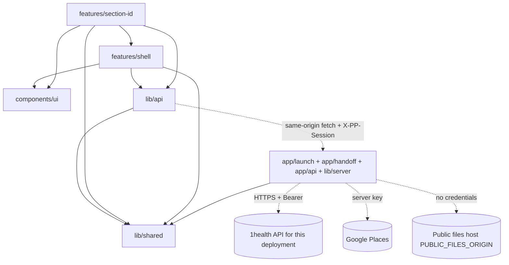
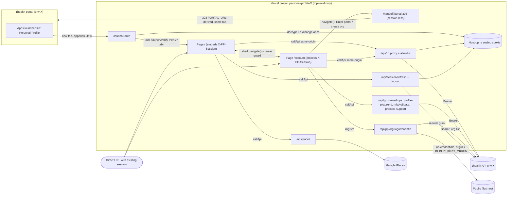
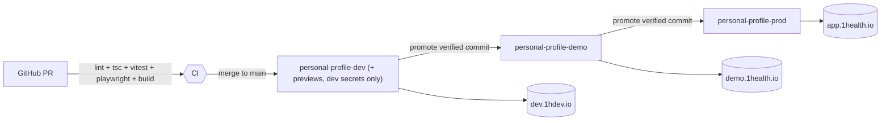

# Architecture Spine — Personal Profile (NG-9019)

## Design Paradigm

**Backend-for-Frontend + feature-sliced client.**
- The Next.js server is the only thing that holds 1health tokens and talks to 1health.
- The browser talks only to the app's own origin, and only through `callApi` (AD-19).
- Client code is sliced by **Section**: each Section is a self-contained feature that plugs into its page's registry.
- Two pages share one shell, session, SWR cache and proxy: `/` (Personal Profile: Contacts, Insurance, Medical) and `/account` (Profile module: Personal Account, Individual Provider Registration, My Organizations). The app bar switches between them (AD-26).
- The app always runs top-level in its own tab, never framed (AD-5). No 1health-fe changes: entry is the portal Apps launcher tile or a direct URL.

| Layer | Lives in | May import |
|---|---|---|
| BFF (server only) | `app/launch/`, `app/handoff/`, `app/api/1h/[...path]/`, `app/api/session/`, `app/api/places/`, `app/api/pp/`, `proxy.ts`, `lib/server/` | `lib/server/*`, `lib/shared/*` |
| API client | `lib/api/*` (`callApi`, session events, one typed module per resource, calls `/api/...` only) | `lib/shared/*` |
| Section features | `features/<section-id>/` (hook, schema, components) | `lib/api`, `features/shell`, `components/ui`, `lib/shared` |
| Shell | `features/shell/` (app bar, tabs, section menu, Section registry, Save all, drafts, `navigate()` + leave guard, session dialogs) | `lib/api`, `components/ui`, `lib/shared` |
| UI kit | `components/ui/` (shadcn on 1health tokens) | nothing app-specific |



## Invariants & Rules

### AD-1 — Tokens never reach the browser; one sealed session cookie
- **Binds:** NFR-1, FR-1, FR-2, `lib/server/session.ts`, every route handler
- **Prevents:** a Section or helper reading a token and calling 1health directly; a user editing plaintext identity or base-URL cookies; subdomain cookie tossing.
- **Rule:**
  - All session state lives in **one** AEAD-sealed cookie `__Host-pp_s` (iron-session, key `SESSION_SECRET`): access token, refresh token, access expiry, `userId`, `personId`, `tenantId`, `sid` (random per launch), `gen` (incremented on each refresh), `iat`, `lastSeen`. Attributes: `HttpOnly; Secure; SameSite=Lax; Path=/`, no `Partitioned` (top-level only, AD-5), no `Domain`, no `Max-Age` (session cookie).
  - The environment and API origin are **never** stored in the cookie; they come only from `lib/server/env.ts` (AD-3).
  - `userId`, `personId` and `tenantId` are derived at launch from the token and `GET /v2/user/myself`, never from the launch payload alone; the payload's user id must equal the token subject.
  - A cookie that fails to unseal is treated as no session. `id_token` is never stored. A unit test asserts the serialized `Set-Cookie` is ≤ 3,800 bytes using the largest observed dev/demo/prod tokens.
  - No response body ever contains a token. The client gets `userId`/`personId` from `myself`, never from cookies.
  - Every route handler and server component calls `requireSession()` itself (the only exception is `/handoff/portal`, AD-22); `proxy.ts` (the Next 16 request interceptor) only redirects as a convenience.
  - Legacy auth is deleted in the first story: `app/api/token/**`, `app/auth/**`, `lib/auth-client.ts`, and the `document.cookie` reads in `contexts/navigation-context.tsx`.

### AD-2 — All 1health traffic goes through one allowlisted, canonicalizing proxy
- **Binds:** NFR-1, NFR-6, `app/api/1h/[...path]/route.ts`, `lib/server/proxy-allowlist.ts`, every `lib/api` module
- **Prevents:** ad-hoc route handlers per feature, path traversal or host swap to non-allowlisted endpoints, acting on another person's record, raw GraphQL bypassing the allowlist, denylist globs blocking needed endpoints, and divergent refresh handling.
- **Rule:**
  - The browser calls `/api/1h/<path relative to the upstream /api>` only, e.g. `/api/1h/v2/user/myself` → `<API_ORIGIN>/api/v2/user/myself`.
  - **Allowlist entry** = `{ method, template, query, body, maxBytes?, asImage? }`, keyed by METHOD + template (the endpoints in the PP addendum §A and Profile addendum §A, minus those moved to named ops below). No match → 403 `NOT_ALLOWED`; known template with another method → 405. `HEAD`, `OPTIONS`, `TRACE`, `X-HTTP-Method-Override` and `_method` are never honored.
  - **Denies** are exact `METHOD + template` matches, except a template ending in `/**`, which is a prefix match. `<n>` in a deny matches `^\d{1,19}$`; `*` as the method means any method. Deny list: `* /auth/**`, `* v2/public/external-application/**`, any admin prefix, `POST v2/mfa/enable`, `POST v2/mfa/disable`, `* v2/mfa/enable/<n>`, `* v2/mfa/disable/<n>`, `* v2/mfa/validate/<n>`, `* v2/user/switch-tenant/**`, `* v2/user/update-password`, `* v2/tenant/sys-config`. Proxy-table test rows: `POST v2/mfa/enable/totp` and `POST v2/mfa/disable/totp` → allowed; `POST v2/mfa/enable` → 403; `POST v2/mfa/enable/123` → 403; `GET v2/mfa/validate/123` → 403.
  - **Owner ids come from the session.** In allow templates, `{personId}` and `{userId}` are filled by the proxy from the sealed session; the client sends the literal segment `me` in those positions, and any other value → 403. Other ids must match `^\d{1,19}$`; literal segments compare exactly.
  - **Query params** are allowlisted per entry (decoded name + value regex, rebuilt with `encodeURIComponent`); unknown params → 400 `BAD_QUERY`. Security-relevant values are fixed server-side and client values ignored: `isPublic=false` for Signature and insurance-card uploads, `isPublic=true` only for the Profile Picture, `hardDelete=true` only on file-delete entries, `preview=true` on every `asImage` file-download entry.
  - **Profile entries (AM-6):** `public/npi/list` → `entityTypeCode` `1|2`, `searchText` ≤ 100 chars, `page` `^\d{1,4}$`, `limit` ≤ 10; `user/organization/portal` → `name` ≤ 100 chars, `page` `^\d{1,4}$`, `size` ≤ 12; `user/time-zone` → `timeZone` ∈ the six IANA ids in `lib/shared/time-zones.ts`; `user/locale` → `locale` = `en-US`; `contact-point/list` → `type` repeatable, each ∈ `Email|Mobile|Landline` (plus the PP types). `PUT v2/user/edit` body schema rejects `locale`; `email`, `phoneNumber`, `phoneNumberRegion` are accepted (AD-9 restricts the caller).
  - **Path normalization, before matching:** reject with 400 `BAD_PATH` if the raw path contains `//`, `%2F`, `%5C`, `%25` (double-encoding), or any raw or decoded segment is empty, `.`, `..`, or contains `/ \ ; % @ :`, whitespace or a control character. The upstream URL is built as `API_ORIGIN + "/api/" + segments.map(encodeURIComponent).join("/")` (never `new URL(input, base)`), then asserted to have origin `API_ORIGIN` and to re-match the same template. A test table of traversal payloads (`..%2F`, `%2e%2e`, `%252F`, `//host`, `;x`, trailing `/`, mixed case) must all return 400/403.
  - **Named server operations** (`app/api/pp/**`) replace passthrough where the proxy can't enforce scope; each requires a session and follows AD-17/AD-18: `GET /api/pp/profile-picture-id` (FR-10, GraphQL document on the server, variables from the session; GraphQL is never proxied), `POST /api/pp/mfa/validate` (JSON body `{ "code": "<6 digits>" }` matching `^\d{6}$`; the server moves it into the upstream `v2/mfa/validate?code=` query, so no code is in any app URL), `GET /api/pp/org-logo/{tenantId}` (AD-24), `GET /api/pp/practice-support` (AD-25). `v2/mfa/validate` and `tenant/sys-config` are not passthrough entries.
  - **Headers:** forwarded request headers are only `Content-Type`, `Content-Length`, `Accept`, `Accept-Language`, plus server-added `Authorization: Bearer` and `X-Request-Id`. Forwarded response headers are only `Content-Type`, `Content-Length`, `X-Request-Id`; `Content-Disposition` and caching headers are generated by the proxy (AD-13, AD-18). Upstream `Set-Cookie` and CORS headers are dropped.
  - Upstream `fetch` uses `redirect: "manual"` (a 3xx → 502 `UPSTREAM_REDIRECT`) and a 25 s timeout (→ 504 `UPSTREAM_TIMEOUT`); request and response bodies stream, never buffered except upload entries (AD-13).
  - **Refresh is not the proxy's job.** On upstream 401, or an access token already past expiry (30 s skew), the proxy returns `401 {errorCode:"TOKEN_EXPIRED", source:"proxy"}` and writes no cookie. There is no in-proxy lock. Refresh is AD-16.
  - The proxy also enforces AD-17 (CSRF + session binding) and AD-18 (no cache). Adding an endpoint means adding an allowlist entry in the same change.

### AD-3 — Each deployment is pinned to one environment
- **Binds:** NFR-6, FR-1, `lib/server/env.ts`, deployment
- **Prevents:** a deployment holding secrets for several environments, or a launch from env A being exchanged against env B.
- **Rule:**
  - Three deployments, one per environment, each with its API origin fixed in `lib/server/env.ts`: **dev → `https://dev.1hdev.io`**, **demo → `https://demo.1health.io`**, **prod → `https://app.1health.io`**.
  - Each one sets `APP_ENV` and holds only its own `ONEHEALTH_SECRET_KEY` and `APP_ID` (AD-20).
  - `lib/server/env.ts` is the only reader of server `process.env` and exports `API_ORIGIN`, `APP_ORIGIN`, `PORTAL_URL`, `PUBLIC_FILES_ORIGIN`, `APP_ID`, `DEFAULT_TENANT_ID`; it fails the boot if any is missing. `PUBLIC_FILES_ORIGIN` is a per-environment env var (origin of `tenantLogo.publicUrl`, AD-24).
  - The manual environment chooser and referrer detection are removed. Each environment's External Application registration points to its own deployment's launch URL (AD-4).

### AD-4 — Launch is a one-shot server exchange at `/launch`
- **Binds:** FR-1, FR-3 deep links, FR-101, UJ-3, `app/launch/**`, `proxy.ts`, `lib/server/http.ts`
- **Prevents:** the launch story and the registration story choosing different URLs, `lpl` reaching client JS or history, a failed launch leaving the previous user's session, deep links being lost through launch, and `NextResponse.redirect` rejecting relative URLs.
- **Rule:**
  - Entry is the portal Apps launcher tile "Personal Profile" (launch → `/`) or a direct app URL. No 1health-fe change is required or assumed.
  - The registered launch URL in every environment is **`<APP_ORIGIN>/launch`**; the portal appends `?lpl=…`. A request to **any path** carrying `lpl` (including `/` and `/account`) gets a 307 from `proxy.ts` to `/launch` with the query preserved. No page reads `lpl`.
  - `app/launch/route.ts`:
    0. clears any existing `__Host-pp_s`, whatever the outcome;
    1. normalizes `' '` → `'+'` in `lpl`, then decrypts it as AES-GCM with a 12-byte IV, rejecting a cleartext or malformed payload;
    2. rejects a payload whose app id ≠ `APP_ID`;
    3. exchanges the code exactly once (no retry);
    4. derives ids (AD-1) and checks the tenant (AD-6);
    5. sets the sealed cookie with a new `sid`;
    6. answers **303 → `/launch/verify?tab=<tab>`**, which re-reads the cookie and answers 303 → `/?tab=<tab>`, or → `/launch-error?reason=cookies` if the cookie did not stick.
  - Launch always lands on `/`. `tab` ∈ `contacts|insurance|medical` (default `contacts`); an invalid value falls back to the default, never to an error. There is no `view` param.
  - `/account` is reached by in-app navigation (AD-26) or a direct URL with an existing session; with no session it shows the launch-error screen.
  - All redirects use `lib/server/http.ts#seeOther(url)` (303, absolute `Location`) built only from `APP_ORIGIN` + an enum path + enum query values. Redirects carry no fragment, so the browser keeps the original one (`#signature` survives). `NextResponse.redirect` is banned in `app/launch/**` and `app/handoff/**` (lint rule).
  - Failures redirect to `/launch-error?reason=<expired|used|invalid|tenant|cookies|config|disabled>`; unknown values render `invalid`, and the raw value is never rendered or logged. Copy is module-neutral and verbatim from EXPERIENCE Voice and Tone (AD-11).
  - A request with no session and no `lpl` shows the launch-error screen. There is no login page.

### AD-5 — App runs top-level only, never framed
- **Binds:** FR-1, NFR-7, `proxy.ts`, `app/launch-error`, deployment
- **Prevents:** framed-host branches, cookie-partition failures, sandbox-inherited popups, and clickjacking.
- **Rule:**
  - Every response, including `/api/**`, `/launch-error` and static assets, carries CSP `frame-ancestors 'none'` and `X-Frame-Options: DENY`. The portal `ExternalAppFrame` is not a supported host.
  - There is no framed detection, no `postMessage` listener or sender, and no `target=_blank` except the external-link exception below.
  - `reason=cookies` renders a plain message with a Retry action that relaunches through `PORTAL_URL` (same tab). No new-tab fallback.
  - App-bar "Return to 1health" targets the constant `PORTAL_URL`, same tab, after the leave guard (AD-26). There is no `returnUrl`/`next` param anywhere. Portal hand-offs follow AD-22 (same tab after the leave guard).
  - **Exception (2026-10-13):** links to external, non-1health sites (the organization checkout site, social media links) may use `target=_blank rel="noopener noreferrer"`. Portal and 1health destinations never do; they go through AD-22 or AD-26.

### AD-6 — The default (patient) tenant is required
- **Binds:** FR-1, PRD §2.2, FR-102
- **Prevents:** editing a profile under an organization-pinned token whose permissions differ from today's `/profile`.
- **Rule:** after the exchange, the launch route compares the token's tenant with `DEFAULT_TENANT_ID` (`1`, from `lib/server/env.ts`). If they differ, no session cookie is set, no data is fetched, and it redirects to `/launch-error?reason=tenant` (module-neutral copy from EXPERIENCE). 1health-fe does no tenant switch before launching; this check is the only guard.

### AD-7 — Section contract and registry
- **Binds:** FR-3, FR-4, FR-5, FR-6, FR-2 drafts, FR-109, every `features/<section-id>`
- **Prevents:** Sections inventing their own dirty, save or draft semantics; hash anchors that differ from EXPERIENCE.md; retries that re-send already-applied steps; tab and Section ids colliding across pages.
- **Rule:**
  - **One `SectionRegistry` per page** (AM-2): `/` and `/account` each mount their own; dirty count, leave guard and draft write/restore are scoped to the page. Draft purge is user-wide (AD-12).
  - Every Section registers with `SectionRegistry` through `useRegisterSection({ id, label, displayOrder, form, validate(), save(), discard(), draftFields })`.
  - **Save all, the leave guard, the dirty count and draft persistence talk only to the registry.**
  - `save()` resolves to `{ ok: true } | { ok: false, error }` and **never throws**. A multi-request save runs its steps in a fixed order; on any step failure it refetches its SWR keys and rebases the form baseline before returning `{ ok: false }`, so a retry sends only the remaining diff.
    - Personal information: `PUT /v2/user/edit`, then Signature upload-then-delete.
    - Addresses: PUT the new Primary first, then other PUT/POST, then DELETE.
    - Insurance: the policy, then the demoted policy, then card images.
    - **Account settings (`/account`), exception to stop-on-failure:** `PUT /v2/user/edit` first (dirty fields only; `email`/`phoneNumber` only when changed, AD-9); then `POST user/time-zone` and `POST user/locale` (each only if dirty) are **both attempted** whatever the other steps' results. The result is `{ ok: false, error: { failedParts: ("details"|"timeZone"|"locale")[] } }` when any part fails; each succeeded part is re-baselined (PRD FR-109). `SESSION_EXPIRED`/`SESSION_CHANGED` stops the sequence.
  - **Ids are typed enums per page**: `ProfileTab` (`contacts|insurance|medical`), `AccountTab` (`personal|provider|organizations`), `SectionId`. Cross-page links use only `navigate()` (AD-26), never a bare id.
  - **Section ids are the EXPERIENCE.md anchors**, and are also the feature folder names, draft keys and telemetry ids:

    | Section | id = URL hash | displayOrder |
    |---|---|---|
    | 01 Personal information | `personal` (sub-anchor `#signature` scrolls to its Signature row; not a Section) | 1 |
    | 02 Phone | `phone` | 2 |
    | 03 Email | `email` | 3 |
    | 04 Social media | `social` | 4 |
    | 05 Addresses | `addresses` | 5 |
    | `/account` Personal account settings | `account` | 1 |
    | `/account` Authenticator app (anchor only, not a Section) | `authenticator` | none |

  - On `/account`, `account` is the only registry Section. The Authenticator app, Healthcare credentials and My Organizations are not registry Sections: they have no dirty state and no drafts.
  - Unknown tab → the page's default tab; unknown hash → top of tab.
  - Insurance is not a Save-all Section: its drawer saves on its own. It registers as a **guard-only participant** (`saveAll: false, draftFields: []`) so a dirty drawer still arms the leave guard.

### AD-8 — Save all is sequential in a fixed order
- **Binds:** FR-5, FR-17, FR-21, NFR-5
- **Prevents:** running Contact Point batches in parallel, which can race on the backend's Primary rules, and auto-verify firing against a list that isn't final.
- **Rule:**
  - Validate every dirty Section first. If any fails, nothing is sent.
  - Then save sequentially in `SAVE_ORDER = personal → email → phone → social → addresses`, a constant in `features/shell` (independent of `displayOrder`).
  - Save all exists only on `/`. `/account` has no Save all; its one Section saves on its own.
  - A failure doesn't stop later Sections. A `SESSION_EXPIRED` or `SESSION_CHANGED` (AD-19) stops the run.
  - Each Contact Point Section runs its own auto-verify straight after its own successful save.
  - The toast reports "X saved, Y failed".

### AD-9 — Contact Points use one engine
- **Binds:** FR-15–FR-24, FR-107, `features/phone`, `features/email`, `features/social`, `features/account`, `lib/api/account.ts`
- **Prevents:** three diverging copies of the diff, Primary-switch and verify logic, and any module other than Account settings changing the login email or phone.
- **Rule:**
  - Phone, Email and Social use the shared `lib/api/contact-points.ts`:
    - `diffToManageDTO(before, after)` builds `contactPointsToAdd/Update/Remove`;
    - a Primary switch puts the new Primary **and** the old one, relabeled `"Old"`, in the same `contactPointsToUpdate`;
    - `newUnverified(before, after)` drives auto-verify (label ≠ Home).
  - The Contact Label list is the backend enum intersected with `/type/key/ContactPoint`, minus "Partnership Organization", defined once in `lib/shared/contact-labels.ts`.
  - `PUT /v2/user/edit` is never sent `email`, `phoneNumber` or `phoneNumberRegion`, **except** through `lib/api/account.ts#updateAccount()` (AM-4, PRD FR-107 parity), the sole builder of those fields: only when changed, only values from Verified Email / Mobile / Landline Contact Points, `phoneNumberRegion` always sent with `phoneNumber`. The Personal-information payload type omits the three fields. ESLint `no-restricted-imports` allows `updateAccount` only in `features/account`.

### AD-10 — Server state goes through SWR, with one key per resource
- **Binds:** all reads, FR-9 header refresh, FR-13, FR-101, NFR-4
- **Prevents:** duplicate fetches, stale headers, Sections caching PHI in ad-hoc state, combined cache keys that miss invalidation, and per-page caches drifting.
- **Rule:**
  - Reads use SWR with keys from `lib/api/keys.ts` and the shared fetcher built on `callApi` (AD-19). Every key starts with `"pp"` (enforced in `keys.ts`). One `SWRConfig` sits in the root layout, so `/` and `/account` share one cache.
  - Key families: `keys.myself()` = `["pp","myself"]`; `keys.contactPoints(type)` = `["pp","contact-points",type]`, the only contact-point family, shared by Contacts and the `/account` pickers (a multi-type read composes per-type keys); `/account`: `["pp","npi"]`, `["pp","orgs",name,page]`, `["pp","practice-support"]`.
  - After a successful save, the Section calls `mutate` on its own keys and on the keys it affects: Personal information and Account settings refresh `myself` (header); Account settings also mutates `contactPoints("Email"|"Mobile"|"Landline")`.
  - A tab's keys load only when the tab is opened; no prefetch of other tabs.
  - There is no other global client store besides `SectionRegistry`. `contexts/session-context.tsx` (`session:user`) is replaced by the `myself` key.
  - **MFA QR codes and codes are never put in SWR, drafts, storage or logs.** The QR data URI lives in the dialog's component state and is dropped on close and on `pagehide`.
  - **The revealed SSN is never put in SWR or any cache.** It is fetched by `revealSsn()`, held in component state, and cleared after 30 s, on blur, on `visibilitychange` and on `pagehide`.

### AD-11 — Forms: react-hook-form + zod schemas per Section
- **Binds:** FR-4, FR-12, FR-16, FR-20, FR-24, FR-26, FR-29, FR-105
- **Prevents:** mixed validation libraries, error copy drifting away from EXPERIENCE.md, stored `javascript:` links, and two pages validating the same person fields differently.
- **Rule:**
  - Each Section owns `features/<section-id>/schema.ts` (zod 4) and one `useForm` instance, with `zodResolver`.
  - **Shared person rules** live once in `lib/shared/person-rules.ts`, imported by `features/personal` and `features/account`: first/last name 1–24 chars after trim; birth date age 18–120, or 21–120 when `myself.roles` includes Proctor. No schema redefines them.
  - Error messages are keys into `lib/shared/messages.ts`. Their copy is the EXPERIENCE.md Voice and Tone table, verbatim.
  - Mapping backend errors (AD-19) to fields and messages happens only in `lib/api/errors.ts`.
  - URL-like fields (Social media) validate `^https://` or a handle pattern at input. Data-derived links render only through `safeHref()`, which returns `undefined` unless the protocol is `https:`, `mailto:` or `tel:`. No `dangerouslySetInnerHTML` (lint rule).

### AD-12 — Drafts in localStorage, keyed to the user and versioned
- **Binds:** FR-2, UJ-5, UJ-105, `features/shell/drafts.ts`
- **Prevents:** health data leaking between users on a shared device, stale drafts overwriting newer server data, sensitive fields being persisted, the session-expired path losing the edits it promises to keep, and a per-page purge leaving the other page's drafts behind.
- **Rule:**
  - Storage is `localStorage` (so a relaunch in a new tab finds the draft). Key: `pp:draft:v1:<userId>:<sectionId>`. Value: `{ savedAt, baseHash, values }`.
    - `baseHash` = stable hash of the **server values of exactly the Section's `draftFields`** (read from `myself` / contact-point keys), so an edit on either page invalidates the other page's draft of shared fields.
    - `values` holds only the Section's explicit `draftFields` allowlist; SSN, Signature, Insurance, MFA codes and NPI selections are never drafted.
  - Registries own write and restore only: write on change (debounced 500 ms) and immediately before the session-expired dialog opens.
  - **Purge is user-wide**, by the shell helper `drafts.purgeUser(userId)` deleting `pp:draft:v1:<userId>:*`, never by a registry. It runs on app-bar "Return to 1health" (after the leave-guard confirm) and on `SESSION_CHANGED` (for the in-memory `myself` user; no draft is written).
  - Per-Section delete: on that Section's save and discard. Expiry: on read when `savedAt` is older than 24 h; all expired `pp:draft:*` keys are purged at app start.
  - Drafts are **kept** on the session-expired dialog's "Return to 1health" and on portal hand-offs (AD-22). No other path deletes drafts.
  - Drafts are offered only when the key's `userId` equals the current `myself` id. On restore, if `baseHash` ≠ the current server hash, the app shows the per-Section conflict UI (EXPERIENCE.md). It never merges automatically.

### AD-13 — Files and images go through proxy URLs, uploads ≤ 4 MB
- **Binds:** FR-10, FR-14, FR-28–FR-31, FR-114, NFR-1
- **Prevents:** uploads failing on Vercel's 4.5 MB function body limit, blob/token plumbing in components, non-image content stored as images, and SVG/HTML rendering inline.
- **Rule:**
  - **Client:** before upload, images are downscaled/re-encoded on a canvas to ≤ 4 MB. User-facing accepted inputs stay as specified: Profile Picture JPG/PNG/BMP up to 6 MB; insurance card PNG/JPEG up to 10 MB and 6000×4000 px; Signature drawn or uploaded PNG/JPEG, always converted to PNG on the client.
  - **Proxy upload entries:** `maxBytes` = 4 MB (Signature 1 MB), checked on `Content-Length` and while reading (→ 413 `TOO_LARGE`); `multipart/form-data` with exactly one file part named as the endpoint expects (`file` or `fileNewVersion`); the file's leading bytes must match PNG/JPEG/BMP (Signature PNG only), else 415 `UNSUPPORTED_MEDIA`. Upload bodies may be buffered up to `maxBytes`; nothing else is.
  - **Downloads** stream through without buffering. Images render as `` on `asImage` entries (upstream `preview=true` fixed server-side, AD-2). The proxy serves `inline` only when the declared type is `image/png|jpeg|bmp` and the leading bytes match; otherwise `Content-Disposition: attachment; filename="file"`. `Content-Disposition` is always generated by the proxy, and every proxy response carries `X-Content-Type-Options: nosniff`.
  - Replace-then-delete order: upload the new file, then delete the old one. A failed delete doesn't fail the save.
  - Organization logos follow AD-24 only; no logo is fetched through `v2/file/{fileInstanceId}/download`.

### AD-14 — Address suggestions are server-proxied
- **Binds:** FR-26, NFR-1 CSP, `app/api/places/`
- **Prevents:** a browser-exposed Places key, the CSP needing third-party script, PHI in request URLs, and quota abuse.
- **Rule:**
  - `POST /api/places/autocomplete` and `POST /api/places/details` (JSON bodies) call Google Places (New) server-side with `GOOGLE_PLACES_KEY`. They require a session and pass AD-17.
  - Input ≤ 120 chars; `placeId` matches `^[A-Za-z0-9_-]{10,300}$`; region codes are fixed server-side to US/CA/AU; the field mask is a server constant (address components + formatted address); the Places session token is server-generated and bound to `sid`.
  - The GCP key is restricted to Places API (New) with a hard daily quota cap and budget alert.
  - The routes return an empty suggestion list unless `PLACES_ENABLED=1` for the deployment; manual address entry always works. `PLACES_ENABLED` is set in demo/prod only after the Google BAA (AD-20).
  - No Google script loads in the browser. Typed text is never logged.

### AD-15 — Logging and telemetry carry no PHI
- **Binds:** NFR-1, SM-2, SM-C1, SM-103
- **Prevents:** tokens, SSNs, MFA codes or profile values ending up in logs, URLs or analytics.
- **Rule:**
  - Server logs record only method, upstream path **template**, status, duration and a request id. The app never logs query strings. A global error wrapper logs `{requestId, routeTemplate, status, errorName}` only.
  - Platform request logs may record app URLs, so no app URL carries PHI or secrets: MFA codes travel in a POST body (AD-2 named op); the only exceptions are the encrypted one-time `lpl` on `/launch` and NPI/organization `searchText` (public directory names).
  - Request and response bodies are never logged outside `APP_ENV=dev`, where the debug logger redacts, at minimum, `qrCode`, `code`, `ssn`, tokens and file bodies. 5xx responses to the client never include upstream bodies.
  - Client telemetry goes only through `lib/shared/telemetry.ts` (no-op sink until one is chosen) with events `section_save {sectionId, ok, code}`, `save_all {saved, failed}` and `mfa_link {ok, attempt}`. No field values, no user ids.

### AD-16 — Token refresh is client-coordinated
- **Binds:** FR-2, UJ-5, NFR-4, `app/api/session/refresh/route.ts`, `app/api/session/logout/route.ts`, `lib/api/client.ts`
- **Prevents:** parallel refreshes on different serverless instances racing on the same refresh token, last-write-wins cookie overwrites, logging the user out mid-Save-all, and replaying a non-GET that may have reached upstream.
- **Rule:**
  - On `401 TOKEN_EXPIRED` (proxy-originated), `callApi` runs **one** `POST /api/session/refresh`, single-flighted within the tab (shared promise) and across tabs (`navigator.locks.request("pp-refresh")`), queues the other failed calls, then replays each once. A non-GET is replayed only after a proxy-originated `TOKEN_EXPIRED`, never after a 5xx or timeout.
  - The refresh route: if the cookie's access token is still valid (another tab already refreshed) it returns 200 without calling the IdP; otherwise it refreshes, increments `gen` and re-seals the cookie with the same `sid`.
  - Only an IdP rejection of the refresh token (`invalid_grant`/401) yields `401 {errorCode:"SESSION_EXPIRED"}` and clears the cookie. Network errors and upstream 5xx return 503 `REFRESH_UNAVAILABLE` and keep the session.
  - A replayed call that gets `TOKEN_EXPIRED` again is treated as `SESSION_EXPIRED`.
  - Test: 10 concurrent calls across a simulated expiry produce exactly 1 upstream refresh.
  - **Automatic logoff:** the server rejects with `401 SESSION_EXPIRED` after **15 min without a user-initiated request** (`lastSeen`) or **8 h after launch** (`iat`), whichever comes first. The client shows a warning 60 s before the idle limit with "Stay signed in". Background polling does not count as activity.
  - App-bar "Return to 1health" calls `POST /api/session/logout`, which clears the cookie and revokes the tokens upstream (best effort if no revoke endpoint exists; see Open Questions). Portal hand-offs do not (AD-22).

### AD-17 — CSRF defence and per-tab session binding
- **Binds:** NFR-1, `app/api/**`, `lib/api/client.ts`, `app/page.tsx`, `app/account/page.tsx`
- **Prevents:** cross-site form posts forging a Signature or Profile Picture, and a tab opened by user A writing into user B's profile after B launches in another tab.
- **Rule:**
  - Every page server component (`app/page.tsx`, `app/account/page.tsx`) embeds `sessionBinding = HMAC(SESSION_SECRET, sid)` in the page; `callApi` sends it on every request as `X-PP-Session`. Nothing else sets that header.
  - Every non-GET request to `/api/1h/*`, `/api/places/*`, `/api/session/*` and `/api/pp/*` must have `Sec-Fetch-Site: same-origin` (or, when absent, `Origin` = `APP_ORIGIN`) **and** `X-PP-Session`; otherwise 403 `CSRF`. A request with neither `Sec-Fetch-Site` nor `Origin` is rejected.
  - Any request whose `X-PP-Session` doesn't match the current cookie's `sid` gets **409 `SESSION_CHANGED`** (proxy-originated). GET requests without the header are allowed only on `asImage` entries and `GET /api/pp/org-logo/*`.
  - JSON entries reject any `Content-Type` other than `application/json`. GET handlers, including `/handoff/portal`, have no side effects.

### AD-18 — PHI is never cached
- **Binds:** NFR-1, `app/api/**`, `app/page.tsx`, `app/account/page.tsx`, `app/launch/**`, `app/handoff/**`
- **Prevents:** one user's profile, SSN, card image or `sessionBinding` being served to another from the Next data cache, the Vercel edge, or a shared browser cache.
- **Rule:**
  - Every server `fetch` to 1health, Google or `PUBLIC_FILES_ORIGIN` uses `{ cache: "no-store" }`.
  - Every page and route handler under `app/` (at least `app/page.tsx`, `app/account/page.tsx`, `app/api/**`, `app/launch/**`, `app/handoff/**`) exports `dynamic = "force-dynamic"`; `cacheComponents` stays off.
  - The proxy and every BFF route **overwrite** response caching headers with `Cache-Control: private, no-store, max-age=0`, `Pragma: no-cache`, `Vary: Cookie`, including images, redirects and error responses; upstream `Cache-Control`, `Expires`, `ETag` and `Last-Modified` are dropped.
  - A CI test asserts these headers on `/`, `/account`, `/handoff/portal`, `/api/pp/org-logo/1` and a sample of allowlisted routes; no `s-maxage` appears in config.

### AD-19 — `callApi` is the single client transport and session signal
- **Binds:** FR-2, FR-103, UJ-5, AD-11 error mapping, `lib/api/client.ts`, `lib/api/errors.ts`, `lib/api/session-events.ts`
- **Prevents:** the session-expired dialog firing only on SWR reads and never on Save, each Section parsing backend errors its own way, backend integer codes colliding with proxy string codes, and proxy bugs rendering as "no access".
- **Rule:**
  - Every browser request goes through `callApi(context, path, init)` (keeps its signature). It adds `X-PP-Session` (AD-17), runs refresh (AD-16), and returns `ApiResponse<T> = { success, data?, error?, statusCode?, errorCode?, upstreamCode?, details? }`.
  - **Two error envelopes, never mixed:** BFF-originated errors are `{ errorCode: "<STRING>", source: "proxy" }`; upstream errors pass through as `{ message, code: <int> }`. `callApi` parses once: the BFF string goes to `errorCode`; the backend integer goes to `upstreamCode`; `lib/api/errors.ts` derives `errorCode` for upstream errors.
  - Session signals branch on `errorCode`, never on status alone (a backend 409 is not `SESSION_CHANGED`). On `SESSION_EXPIRED` or `SESSION_CHANGED`, `callApi` publishes that event once on `lib/api/session-events.ts`. The shell subscribes:
    - `session-expired` → the registry writes drafts (AD-12), then the non-dismissable "Your session ended" dialog opens.
    - `session-changed` → clear the SWR cache, the registries, `drafts.purgeUser` (AD-12) and any in-memory SSN, write no draft, and show "This profile was opened by another account in another tab" with a Reload button.
  - **`FORBIDDEN`** = status 403 with no `source:"proxy"`, i.e. an upstream 403 only. Proxy `NOT_ALLOWED` and `CSRF` are bugs: generic error with Retry, logged by request id, never "no access".
  - `lib/api/errors.ts` owns the exact-message table for errors that carry no backend code, and nothing else matches message text: `"Mfa is not enabled for this user."`, `"Mfa config is missing."` → `MFA_NOT_ENABLED`; `"Totp is already enabled."` → `TOTP_ALREADY_ENABLED` (refetch `myself`, show linked state); `PERSONAL_NPI_IS_ALREADY_REGISTERED` / `PRACTICE_NPI_IS_ALREADY_REGISTERED` prefixes → `NPI_ALREADY_REGISTERED`.
  - The SWR fetcher and `onError` reuse the same event; no other module opens these dialogs.

### AD-20 — Deployment and operations envelope
- **Binds:** NFR-6, NFR-1, AD-3, deployment, CI
- **Prevents:** prod secrets in preview builds, unregistered launch URLs, untested builds reaching demo/prod, no way back from a bad release, and PHI flowing through vendors without a BAA.
- **Rule:**
  - **Vercel, three projects:** `personal-profile-dev`, `personal-profile-demo`, `personal-profile-prod`. Each project's production domain is its `APP_ORIGIN` (default `https://personal-profile-<env>.vercel.app` until a custom domain is set), and `<APP_ORIGIN>/launch` is that environment's registered External Application launch URL.
  - **Promotion:** the dev project auto-deploys `main`. Demo and prod deploy only by promoting a commit already verified on dev.
  - **Secrets** live only in each project's Vercel environment variables: `ONEHEALTH_SECRET_KEY`, `APP_ID`, `GOOGLE_PLACES_KEY`, `SESSION_SECRET` (plus non-secret `APP_ENV`, `PORTAL_URL`, `PUBLIC_FILES_ORIGIN`, `PLACES_ENABLED`, `PP_DISABLED`, `ACCOUNT_DISABLED`). No `NEXT_PUBLIC_*` secret, no `_DEMO`/`_PROD`-suffixed names. Owner: Daniel Garcia.
  - **Rotation:** `SESSION_SECRET` rotates with the previous value accepted for unseal during the overlap (`SESSION_SECRET_PREVIOUS`); `ONEHEALTH_SECRET_KEY`/`APP_ID` rotate in the External Application registration and Vercel together, then redeploy; `GOOGLE_PLACES_KEY` rotates in GCP. Rotate on any suspected exposure or team change, and at least yearly.
  - **Previews** exist only in the dev project and hold only dev secrets; preview deployments are disabled on the demo and prod projects.
  - **Local development:** `pnpm dev` with `next dev --experimental-https` and `APP_ENV=dev`. A dev-only page `app/launch/dev/page.tsx` accepts a pasted `lpl` and submits it to `/launch`; it returns 404 unless `APP_ENV=dev`.
  - **CI on every PR:** `pnpm lint`, `tsc --noEmit`, Vitest, Playwright (mocked proxy), `next build`. `typescript.ignoreBuildErrors` and `eslint.ignoreDuringBuilds` are removed from `next.config.mjs`. A CI grep fails on `document.cookie`, `access_token` in client files, `NEXT_PUBLIC_*SECRET*`, and `_DEMO`/`_PROD` secret names.
  - **Rollback:** Vercel instant rollback to the previous production deployment. Incident stop: `PP_DISABLED=1` + redeploy makes launch and the proxy return 503 `SERVICE_DISABLED`; `ACCOUNT_DISABLED=1` does the same only for `/account`, `/handoff/**`, `/api/pp/{mfa,org-logo,practice-support}/**` and the Profile allowlist entries; revoking access for live tokens is `isAllowedForPatients=false` on the External Application.
  - **BAA precondition (owner Daniel Garcia):** no demo or prod deployment processes real PHI until BAAs are executed with Vercel (functions, logs, any log drain) and Google (Places). Telemetry and log sinks are added only with a BAA.

### AD-21 — Security headers are set in one place
- **Binds:** NFR-1, AD-5, `proxy.ts`
- **Prevents:** inline-script XSS driving the proxy as the user, framing, and headers drifting per route.
- **Rule:**
  - `proxy.ts` sets, on every response, a per-request nonce CSP: `default-src 'self'; script-src 'self' 'nonce-<n>' 'strict-dynamic'; style-src 'self' 'unsafe-inline'; img-src 'self' blob: data:; connect-src 'self'; font-src 'self'; object-src 'none'; base-uri 'none'; form-action 'self'; frame-ancestors 'none'; upgrade-insecure-requests`.
  - Also: `X-Frame-Options: DENY`, `Strict-Transport-Security: max-age=63072000; includeSubDomains`, `X-Content-Type-Options: nosniff`, `Referrer-Policy: no-referrer`, `Permissions-Policy: camera=(), microphone=(), geolocation=()`, `Cross-Origin-Opener-Policy: same-origin`.
  - A test asserts these headers on `/`, `/account`, `/handoff/portal`, `/launch-error` and one `/api/1h` route.

### AD-22 — Portal hand-offs go through one server route
- **Binds:** FR-116, FR-119, FR-120, UJ-104, `app/handoff/portal/route.ts`
- **Prevents:** each card or button building portal URLs its own way, client code reading portal config, open redirects, extra target params, and the app calling the tenant switch (which revokes its own token).
- **Rule:**
  - Hand-off links point at `GET /handoff/portal?to=tenant&tenantId=<n>` or `GET /handoff/portal?to=create-org`. The route validates `to` against the enum and `tenantId` against `^\d{1,19}$` (else 303 to `PORTAL_URL`), and answers `seeOther()` (AD-4) to a URL built only from `PORTAL_URL` + the enum path + the numeric id: tenant → `<PORTAL_URL>/?ctx=<n>` (candidate, Open Questions); create-org → `<PORTAL_URL origin>/organizations/create`. No other query param is ever emitted (never `assume`).
  - **Session-less by design:** the route reveals nothing and its target is built only from `PORTAL_URL` + enum + numeric id, so it does not call `requireSession()`; `proxy.ts` exempts `/handoff/**` from the no-session redirect.
  - The client triggers it through the shell's `navigate()` (AD-26): leave guard first, then same-tab navigation.
  - A hand-off does **not** call `/api/session/logout` and does **not** clear drafts; drafts are cleared only per AD-12.
  - No app code calls `v2/user/switch-tenant` (denied in AD-2). "Enter portal" renders as a link only when the list item has `enabledInTenant = true`; otherwise it is aria-disabled.

### AD-23 — Profile-module upstream contract
- **Binds:** FR-103–FR-120, `features/account`, `features/mfa`, `features/provider`, `features/organizations`, `lib/api/{account,mfa,npi,organizations,myself}.ts`, `lib/shared/profile-constants.ts`
- **Prevents:** turning on base MFA as a side effect, secret rotation mid-enrolment, NPIs of the wrong type being registered, unstable organization ordering, two sources of practice membership, and each tab choosing its own no-access scope.
- **Rule:**
  - **MFA (parity):** linking calls only `POST mfa/enable/totp`, then `POST /api/pp/mfa/validate` (AD-2); disabling calls only `POST mfa/disable/totp`. A 200 `false` from validate is an invalid code, not an error. Status comes from `myself.mfaEnabled` / `totpEnabled`, refetched after close. Errors map per AD-19.
  - **MFA single-flight:** `enable/totp` is called **once per dialog open**, from the tile's click handler (never a mount effect, so StrictMode double effects and re-renders cannot re-fire it), guarded by an in-flight ref per dialog instance (double-click is a no-op); the dialog renders only the QR of the latest request; no automatic retry or Retry button re-issues it while the dialog is open.
  - **NPI:** `lib/api/npi.ts` exposes `searchPersonalNpi()` (fixes `entityTypeCode=1`) and `searchPracticeNpi()` (fixes `2`); components never pass the type. Registration sends record ids (`providerNpiId`, `practiceNpiId`) after `is-registered` checks on both; the Register button is disabled in flight. The "Register your practice" check uses `practiceNpi.id` from `user/npi`.
  - **Practice membership:** single source = `myself.tenants`. Only `lib/api/myself.ts#isTenantMember(myself, tenantId)` computes it (`tenants.some(t => t.id === tenantId)`); `features/provider` calls it with `practiceNpi.organization.tenantId`. The org list is never used for membership. Support contact comes only from AD-25.
  - **Organizations:** the list is fetched with `size=12`; items with `organization == null` are dropped; the rest are sorted by `shortOrganizationName ?? name` on the client within the page. Empty state = no renderable items on page 0 with no search text; the pager uses the server's `totalPages` as is. Logos per AD-24. Internal-user email domains (`@1health.io`, `@tachin.ai`) and the checkout URL (`https://learnmore.1health.io/product-checkout`) are constants in `lib/shared/profile-constants.ts`.
  - **403 owner table** (upstream `FORBIDDEN` only, AD-19; other tabs and cards keep working):

    | Resource | No-access scope |
    |---|---|
    | `contact-point/list` | Account Section's email/phone pickers only |
    | `mfa/*`, `/api/pp/mfa/validate` | Authenticator app card |
    | `user/npi`, `public/npi/list`, `user/register/npi` | Provider tab |
    | `user/organization/portal` | Organizations tab |
    | `/api/pp/practice-support` | Practice-name support popover only |

### AD-24 — Organization logos come from one named server operation
- **Binds:** FR-118, AM-5, `app/api/pp/org-logo/[tenantId]/route.ts`, `lib/server/env.ts`, `features/organizations`
- **Prevents:** the browser loading third-party image hosts, `img-src` widening, SSRF through a stored URL, non-image or SVG content rendered as a logo, and logos of tenants the user doesn't belong to.
- **Rule:**
  - The browser renders `">`; `` → initials tile. CSP `img-src` stays `'self'`.
  - The route requires a session, validates `tenantId` against `^\d{1,19}$`, and reads the user's org list with a session-scoped upstream call (`GET v2/user/organization/portal`, server-side paging, stop at the match, at most 5 pages of 50). Not a member → 404.
  - It takes that item's `tenantLogo.publicUrl` and requires `new URL(publicUrl).origin === PUBLIC_FILES_ORIGIN` (AD-3), else 404.
  - The fetch sends no credentials or cookies and uses `redirect: "manual"` (3xx → 404), a 5 s timeout, a 512 KB size cap (checked on `Content-Length` and while reading) and `cache: "no-store"`.
  - Only `image/png`, `image/jpeg` and `image/webp` are served, and only when the leading bytes match (PNG, JPEG, `RIFF….WEBP`); SVG and everything else → 404. The response sets `Content-Type` from the matched bytes, `Content-Disposition: inline`, `nosniff` and AD-18 headers.
  - Any failure → 404 `{errorCode:"NO_LOGO", source:"proxy"}`; failures are not errors in the UI. `v2/file/{fileInstanceId}/download` is never used for logos.

### AD-25 — Practice support contact comes from one named server operation
- **Binds:** FR-116, `app/api/pp/practice-support/route.ts`, `features/provider`
- **Prevents:** the client enumerating any tenant's sys-config (no membership check upstream) and stories passing arbitrary tenant ids.
- **Rule:**
  - `GET /api/pp/practice-support` requires a session, reads `GET v2/user/npi` server-side, and takes `practiceNpi.organization.tenantId`; absent → 404.
  - It calls `v2/tenant/sys-config` with exactly `Tenant IDs=<that id>` (name encoded `Tenant%20IDs`) and `includeAllRelations=true`, and returns only `{ name?, phone?, phoneRegion?, email? }` of the support contact. Nothing else from the upstream body reaches the client.
  - SWR key `["pp","practice-support"]`. `v2/tenant/sys-config` is denied in the proxy (AD-2).

### AD-26 — Cross-page navigation and exits go through the shell
- **Binds:** FR-101, FR-107, FR-116, FR-120, `features/shell/navigate.ts`, app bar
- **Prevents:** soft navigations between `/` and `/account` unmounting a dirty registry without a guard, each feature wiring its own leave guard, and hand-offs bypassing the in-app confirm.
- **Rule:**
  - The app bar has two destinations, "Personal Profile" (`/`) and "Account" (`/account`); each page keeps its own tabs.
  - `features/shell` exports `navigate(target)`, with `target` = `{ page: "profile", tab?, hash? } | { page: "account", tab?, hash? } | { external: "portal" | "handoff", href }`. It runs the current page's leave guard (EXPERIENCE three-way dialog), then:
    - between `/` and `/account`: client navigation (`router.push`), keeping the shared SWR cache (AD-10);
    - external (Return to 1health, `/handoff/portal`): same-tab `location.assign`, with Return also applying AD-12 purge and AD-16 logout.
  - `next/link` and raw `<a href>` to `/`, `/account`, `/handoff/**` or `PORTAL_URL` are banned outside `features/shell` (lint rule). `beforeunload` covers only browser-initiated unloads.

## Consistency Conventions

| Concern | Convention |
| --- | --- |
| Naming | Section ids are the EXPERIENCE anchors (AD-7); feature folders use the same ids. Tab ids are typed per page (`ProfileTab`, `AccountTab`). Hooks are `use<Section>`, schemas `<section>Schema`, `lib/api` functions are verb-first (`fetchX`, `saveX`, `verifyContactPoints`). Owner-id path segments are the literal `me` (AD-2). |
| Data & formats | Dates go over the wire as `YYYY-MM-DD` and display as `MM/DD/YYYY`. Clearing an optional field sends `"n/a"`. Ids are numbers. Every `lib/api` call returns `ApiResponse<T>` with `errorCode`/`upstreamCode` (AD-19). |
| Errors | The proxy passes upstream status and body (`{message, code:int}`) through on 4xx. BFF-originated errors have body `{ errorCode, source:"proxy" }`: 400 `BAD_PATH`/`BAD_QUERY`/`BAD_BODY`, 403 `NOT_ALLOWED`/`CSRF`, 404 `NO_LOGO`, 405, 409 `SESSION_CHANGED`, 413 `TOO_LARGE`, 415 `UNSUPPORTED_MEDIA`, 401 `TOKEN_EXPIRED`/`SESSION_EXPIRED`, 502 `UPSTREAM_REDIRECT`/`UPSTREAM_ERROR`, 503 `REFRESH_UNAVAILABLE`/`SERVICE_DISABLED`, 504 `UPSTREAM_TIMEOUT`. `lib/api/errors.ts` maps upstream errors (backend: `SOCIAL_SECURITY_NUMBER_EXISTS`, `INVALID_ENUM_VALUE`, duplicate, primary rules; Profile: upstream 403 → `FORBIDDEN`, exact-message table → `MFA_NOT_ENABLED`, `TOTP_ALREADY_ENABLED`, `NPI_ALREADY_REGISTERED`) to message keys. Proxy `NOT_ALLOWED`/`CSRF` and unknown codes fall back to a generic Section error with Retry. |
| Auth/session | Client-side session signals are only the `session-expired` and `session-changed` events from `lib/api/session-events.ts` (AD-19). |
| Navigation | Cross-page and external navigation only via the shell's `navigate()` (AD-26). Same tab always for 1health destinations; `target=_blank rel="noopener noreferrer"` only for external non-1health links (AD-5 exception). |
| Config | Server config lives in `lib/server/env.ts` (incl. `PORTAL_URL`, `PUBLIC_FILES_ORIGIN`). Client code reads only `NEXT_PUBLIC_APP_ENV`. Nothing else reads `process.env`. App constants (time zones, internal domains, checkout URL) live in `lib/shared`. |
| Styling | Tailwind v4 utilities on the 1health tokens in `app/globals.css`, using the DESIGN.md overrides: link `#256a8c`, destructive fill `#b23a31`, control border `#7a8696`. No hex values in components. |
| Testing | Unit/component tests use Vitest + Testing Library + MSW at the `/api` boundary. End-to-end tests use Playwright for UJ-1…UJ-5 and UJ-101…UJ-105 against a mocked proxy, top-level only, with the Profile parity checklist (Profile addendum §E). Each Section ships tests for `validate`/`save`/diff. The proxy ships the traversal, denylist, CSRF, cache-header and refresh-concurrency tables (AD-2, AD-16–AD-18); `/api/pp/org-logo` ships host, redirect, size and magic-byte rows (AD-24). |

## Stack

| Name | Version |
| --- | --- |
| Node.js | 24.x (runtime; `@types/node` ^24) |
| Next.js (App Router) | 16.4.0 |
| React / React DOM | 19.3.0 |
| TypeScript | 6.0.3 (7.0 not yet supported by typescript-eslint) |
| Tailwind CSS / @tailwindcss/postcss | 4.3.3 |
| shadcn/ui + Radix (dialog 1.3.1, label 2.1.17, slot 1.5.0, toast 1.3.1) | as listed |
| lucide-react | 1.56.0 |
| tailwind-merge | 3.7.0 |
| SWR | 2.5.1 |
| react-hook-form | 7.90.0 |
| @hookform/resolvers | 5.9.1 |
| zod | 4.6.7 |
| libphonenumber-js | 1.13.15 |
| signature_pad | 5.1.4 (wrapped directly; replaces `react-signature-canvas`) |
| iron-session | 9.0.1 |
| ESLint / eslint-config-next | 10.12.0 / 16.4.0 (flat config, `pnpm lint` = `eslint .`) |
| pnpm | 12.x via corepack |
| Vitest / @testing-library/react / MSW / @playwright/test | 5.0.4 / 16.3.3 / 3.0.3 / 1.64.0 |
| Hosting | Vercel, 3 projects (AD-20); function request body limit 4.5 MB |

## Structural Seed





```text
proxy.ts                   # AD-21 headers + nonce, AD-4 any-path ?lpl → /launch 307, no-session redirect (exempts /handoff/**)
app/
  layout.tsx               # root SWRConfig (AD-10), app bar
  launch/route.ts          # AD-4 one-shot exchange → 303
  launch/verify/route.ts   # AD-4 cookie read-back
  launch/dev/page.tsx      # AD-20 dev-only lpl paste (404 unless APP_ENV=dev)
  launch-error/page.tsx    # FR-1 failures (reason enum), tenant mismatch, cookies retry
  page.tsx                 # Personal Profile (tabs contacts|insurance|medical); requireSession; embeds sessionBinding
  account/page.tsx         # Profile module (tabs personal|provider|organizations); requireSession; embeds sessionBinding
  handoff/portal/route.ts  # AD-22 session-less portal hand-off 303
  api/1h/[...path]/route.ts# AD-2 proxy
  api/session/{refresh,logout}/route.ts # AD-16
  api/pp/profile-picture-id/route.ts    # AD-2 named GraphQL op
  api/pp/mfa/validate/route.ts          # AD-2 named op (code in body)
  api/pp/org-logo/[tenantId]/route.ts   # AD-24
  api/pp/practice-support/route.ts      # AD-25
  api/places/{autocomplete,details}/route.ts # AD-14
lib/
  server/                  # env.ts, session.ts (seal, requireSession), http.ts (seeOther), proxy-allowlist.ts, csrf.ts, cache-headers.ts
  api/                     # client.ts (callApi), session-events.ts, typed modules, contact-points.ts, account.ts, myself.ts, keys.ts, errors.ts
  shared/                  # messages.ts, person-rules.ts, contact-labels.ts, time-zones.ts, profile-constants.ts, telemetry.ts, safe-href.ts, types
features/
  shell/                   # app bar, tabs, section menu, SectionRegistry, SAVE_ORDER, SaveAll, drafts (purgeUser), navigate + leave guard, session dialogs
  personal/  phone/  email/  social/  addresses/  insurance/  header/  medical/
  account/  mfa/  provider/  organizations/   # /account (AD-7, AD-23)
components/ui/             # shadcn on 1health tokens
```

| Brownfield item | Disposition |
| --- | --- |
| `app/api/token/`, `app/auth/`, `lib/auth-client.ts` | Delete (AD-1, AD-4) |
| `contexts/navigation-context.tsx`, `contexts/session-context.tsx`, `hooks/use-session-expired.ts`, `components/auth-exit-dialog.tsx` | Replace with `features/shell` + `lib/api/session-events.ts` (AD-10, AD-19, AD-26) |
| `components/home-page-client.tsx`, `components/settings-page.tsx`, `components/workflow/` | Replace with the profile page and Sections |
| `lib/api/client.ts` | Keep `callApi` signature; extend per AD-19 |
| `lib/api/*` workflow, campaign, journey, grid, attachments, comments, custom-data, partnerships, query, schema, step-config, tenant modules | Delete (not allowlisted) |
| `next.config.mjs` | Remove `ignoreBuildErrors` (AD-20) |

## Capability → Architecture Map

| Capability / Area | Lives in | Governed by |
| --- | --- | --- |
| FR-1 launch, FR-2 session | `app/launch`, `app/api/session`, `lib/server/session`, `features/shell` | AD-1, AD-3, AD-4, AD-5, AD-6, AD-12, AD-16, AD-17, AD-19 |
| FR-3–FR-8 shell, deep links, Save all, leave guard | `features/shell` | AD-4, AD-7, AD-8, AD-12, AD-26 |
| FR-9–FR-10 header + picture | `features/header`, `app/api/pp` | AD-2, AD-10, AD-13 |
| FR-11–FR-14 Personal information, SSN, Signature | `features/personal` | AD-7, AD-9 (no email/phone), AD-10 (SSN), AD-11, AD-13 |
| FR-15–FR-24 Phone, Email, Social | `features/phone`, `features/email`, `features/social` | AD-7, AD-8, AD-9, AD-10, AD-11 |
| FR-25–FR-27 Addresses | `features/addresses`, `app/api/places` | AD-7, AD-11, AD-14 |
| FR-28–FR-31 Insurance | `features/insurance` | AD-7 (guard-only), AD-11, AD-13 |
| FR-32 Medical | `features/medical` | none (static panel) |
| FR-101–FR-103 `/account` shell, entry, states | `app/account`, `features/shell` | AD-4, AD-6, AD-7, AD-17, AD-18, AD-19, AD-23, AD-26 |
| FR-104–FR-109 Personal account settings | `features/account`, `lib/api/account.ts` | AD-7, AD-9 (exception), AD-10, AD-11, AD-12 |
| FR-110–FR-112 Authenticator app | `features/mfa`, `app/api/pp/mfa` | AD-2 (denylist, named op), AD-10, AD-15, AD-19, AD-23 |
| FR-113–FR-116 Provider registration | `features/provider`, `app/api/pp/practice-support` | AD-2, AD-13 (signature), AD-22, AD-23, AD-25, AD-26 |
| FR-117–FR-120 My Organizations | `features/organizations`, `app/api/pp/org-logo`, `app/handoff` | AD-22, AD-23, AD-24, AD-26 |
| NFR-1 security | `lib/server`, proxy, `proxy.ts` | AD-1, AD-2, AD-13–AD-18, AD-21, AD-24, AD-25 |
| NFR-2 accessibility | `components/ui`, Sections | EXPERIENCE.md; AD-11 messages |
| NFR-3 design system | `app/globals.css`, `components/ui` | Styling convention |
| NFR-4 performance | `lib/api/keys.ts`, SWR | AD-10, AD-16 |
| NFR-5 reliability | `features/shell`, Sections | AD-7, AD-8, AD-10 |
| NFR-6 environments | `lib/server/env.ts`, Vercel | AD-3, AD-20 |
| NFR-7 browsers, top-level only | `proxy.ts`, `app/launch` | AD-4, AD-5, AD-21 |

## Deferred

- **TypeScript 7:** adopt once typescript-eslint supports it.
- **"Last updated" in the header:** no backing field has been identified; the line is dropped until one is found.
- **Medical tab data model:** Epic 2.
- **Analytics/telemetry sink:** event shapes and the single emitter are fixed by AD-15; the sink is chosen before cutover and needs a BAA (AD-20).
- **Monitoring/alerting** beyond Vercel defaults: after launch, except the minimum set in Open Questions.
- **Server-side session store** (KV + distributed lock): not adopted; revisit if the sealed cookie exceeds 3,800 bytes, if 1health uses refresh-token reuse detection, or if launch-code replay protection is required.
- **Rate limits** on `ssn/expose`, Places and `/api/pp/org-logo` per session: need a shared store; GCP quota caps cover Places cost until then.
- **Change password** (`v2/user/update-password`): out of the Profile release; denied in the allowlist until a story adds it with SSO detection.
- **i18n:** English only in v1. Strings are already centralized (AD-11).
- **Source updates** (spine supersedes; amend sources to match): PP PRD FR-1 (no chooser/referrer detection), FR-2 and EXPERIENCE (localStorage drafts), NFR-6 (three environments); Profile PRD FR-101/FR-102 (no 1health-fe menu wiring or tenant switch; `/account` via app bar), framed-host behaviors (dropped); Profile addendum §C portal hand-off (client-built URL, `location.assign`/`window.open` → AD-22), §A `tenantLogo.publicUrl` in the browser (→ AD-24), §A `tenant/sys-config` from the client (→ AD-25), §A `mfa/validate?code=` from the client (→ AD-2 named op); EXPERIENCE per-page invalid-launch and tenant copy (→ one module-neutral copy, AD-4/AD-6).

## Open Questions

| Question | Owner |
| --- | --- |
| Will `POST /auth/user/logout` also invalidate the refresh token? Today it invalidates only the access token, so after logout the refresh token stays valid upstream for up to 24 h. Request: `_bmad-output/implementation-artifacts/backend-request-refresh-token-revocation.md`. No app change is needed once it ships. | Daniel Garcia / backend |
| Is `auth.client-config.public-client-id` left at `public-client` in demo and prod (no env override)? | Daniel Garcia / backend |
| Launch-code replay (G5, no row lock): accept the 60 s window or get a backend fix? | Daniel Garcia / backend |
| Custom domains for the three projects (replace `personal-profile-<env>.vercel.app`). | Daniel Garcia |
| Is the dev 1health environment synthetic-data only (so the dev project and previews need no BAA)? | Daniel Garcia |
| Minimum alerting before demo QA go/no-go: proxy 5xx rate and `SESSION_EXPIRED` after refresh; Vercel log retention. | Dev lead |
| Portal URL that opens tenant X (candidate `<PORTAL_URL>/?ctx=<n>`; verify `ctx` survives the portal login redirect and the behavior for disabled tenants), asked on NG-9019; fixes AD-22 by 2026-10-17, else hand-off opens `PORTAL_URL`. | Platform team |
| Does every launching user hold Patient functionality in the default tenant (MFA, NPI, org list, edit)? Verify on demo by 2026-10-20. | Platform team / Daniel Garcia |
| `PUBLIC_FILES_ORIGIN` value per environment (dev/demo/prod origin of `tenantLogo.publicUrl`); until set, AD-24 serves 404 and cards show initials. | Dev lead |
| Does changing the login email via `PUT user/edit` keep the current access/refresh tokens valid? Verify on demo; if not, the success path ends in `SESSION_EXPIRED`. | Dev lead |
| Is the 1health backend audit the system of record for SSN expose and Signature changes, or must the proxy emit audit lines to a BAA sink? | Daniel Garcia |

### Answered from backend source (2026-10-13)

Read from `1h-ng-bo-core-be` (`oauth2` module, `master` at `9a7342252e`). Paths are under `oauth2/src/main/java/com/sirma/bocore/auth/`.

| Question | Answer | Evidence |
| --- | --- | --- |
| Is `public-client` the right `client_id` for the refresh grant? | **Yes.** The launch exchange issues its tokens under the registered client looked up by `publicClientId`. The public refresh path accepts exactly one `client_id` and no secret (`ClientAuthenticationMethod.NONE`). Whether demo/prod override the id is still open (above). | `service/impl/ThirdPartyTokenServiceImpl.java:126`; `config/PublicRefreshTokenAuthenticationConverter.java`; `config/CustomPublicClientRefreshTokenAuthenticationProvider.java`; `application.yml:121` |
| Does 1health rotate refresh tokens or detect reuse for `client_id=public-client`? | **It rotates; there is no reuse detection.** `reuseRefreshTokens(false)`, with a 24 h refresh-token TTL; the access-token TTL is half the tenant's token validity (measured: 50 min). Refresh uses Spring's stock `OAuth2RefreshTokenAuthenticationProvider`. A replayed old refresh token isn't found and gets `invalid_grant`, but nothing revokes the rest of the session. AD-16's assumption holds. Because a refresh that loses a race gets `invalid_grant` (→ `SESSION_EXPIRED`), the in-tab and cross-tab single-flight is required, not optional. | `config/AuthorizationServerConfig.java:186-191`; `config/CustomOAuth2RefreshTokenAuthenticationProvider.java`; `config/BocoreJwtTokenCustomizer.java:114` |
| What does `POST /auth/user/logout` revoke? | **The access token only.** It looks up the authorization by the Bearer token and invalidates that token. The refresh token is invalidated only when it is the token passed in (which also invalidates the access token and authorization code). This is acceptable for v1: the refresh token exists only inside the sealed `HttpOnly` cookie that logout clears, and our idle and absolute limits still apply. Full revocation is requested from the backend (open question above). The standard `/oauth2/revoke` isn't usable, because it needs client authentication and `public-client` has none. | `service/TokenRevocationService.java:189-196`, `:243-261`, `:320-339`; `controller/TokenController.java:56` |

## Notes from measurement (2026-10-13)

- **Access token:** a real 1health access token is 1,224 bytes (RS256) and lives 50 min. With an opaque refresh token, the sealed session cookie is about 2 KB, which fits the 3,800-byte budget.
- **Ids come from `/v2/user/myself`.** The `userId`, `personId`, `username`, `roles` and `organizationId` claims are encrypted, and only `tenantId` is plaintext. The launch route must call `GET /v2/user/myself` to get `userId`/`personId` for the session (AD-1, AD-4), and must not decode them from the JWT.
