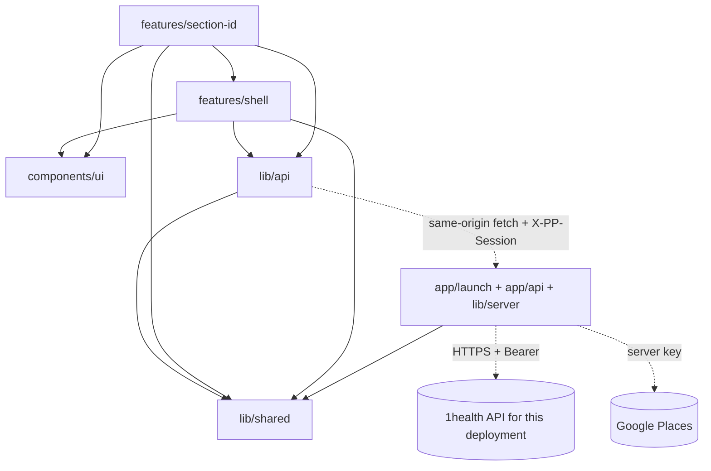
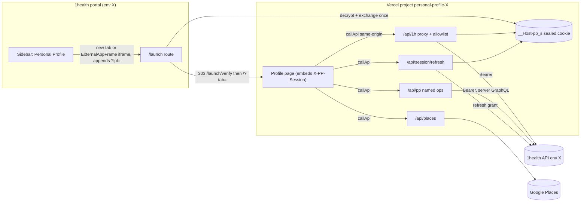
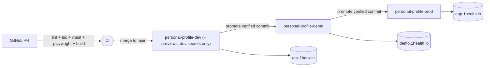

# Architecture Spine — Personal Profile (NG-9019)

## Design Paradigm

**Backend-for-Frontend + feature-sliced client.**
- The Next.js server is the only thing that holds 1health tokens and talks to 1health.
- The browser talks only to the app's own origin, and only through `callApi` (AD-19).
- Client code is sliced by **Section**: each Section is a self-contained feature that plugs into one shared page-level registry.

| Layer | Lives in | May import |
|---|---|---|
| BFF (server only) | `app/launch/`, `app/api/1h/[...path]/`, `app/api/session/`, `app/api/places/`, `app/api/pp/`, `proxy.ts`, `lib/server/` | `lib/server/*`, `lib/shared/*` |
| API client | `lib/api/*` (`callApi`, session events, one typed module per resource, calls `/api/...` only) | `lib/shared/*` |
| Section features | `features/<section-id>/` (hook, schema, components) | `lib/api`, `features/shell`, `components/ui`, `lib/shared` |
| Shell | `features/shell/` (tabs, section menu, Section registry, Save all, drafts, leave guard, session dialogs) | `lib/api`, `components/ui`, `lib/shared` |
| UI kit | `components/ui/` (shadcn on 1health tokens) | nothing app-specific |



## Invariants & Rules

### AD-1 — Tokens never reach the browser; one sealed session cookie
- **Binds:** NFR-1, FR-1, FR-2, `lib/server/session.ts`, every route handler
- **Prevents:** a Section or helper reading a token and calling 1health directly; a user editing plaintext identity or base-URL cookies; subdomain cookie tossing.
- **Rule:**
  - All session state lives in **one** AEAD-sealed cookie `__Host-pp_s` (iron-session, key `SESSION_SECRET`): access token, refresh token, access expiry, `userId`, `personId`, `tenantId`, `sid` (random per launch), `gen` (incremented on each refresh). Attributes: `HttpOnly; Secure; SameSite=None; Partitioned; Path=/`, no `Domain`, no `Max-Age` (session cookie).
  - The environment and API origin are **never** stored in the cookie; they come only from `lib/server/env.ts` (AD-3).
  - `userId`, `personId` and `tenantId` are derived at launch from the token and `GET /v2/user/myself`, never from the launch payload alone; the payload's user id must equal the token subject.
  - A cookie that fails to unseal is treated as no session. `id_token` is never stored. A unit test asserts the serialized `Set-Cookie` is ≤ 3,800 bytes using the largest observed dev/demo/prod tokens.
  - No response body ever contains a token. The client gets `userId`/`personId` from `myself`, never from cookies.
  - Every route handler and server component calls `requireSession()` itself; `proxy.ts` (the Next 16 request interceptor) only redirects as a convenience.
  - Legacy auth is deleted in the first story: `app/api/token/**`, `app/auth/**`, `lib/auth-client.ts`, and the `document.cookie` reads in `contexts/navigation-context.tsx`.

### AD-2 — All 1health traffic goes through one allowlisted, canonicalizing proxy
- **Binds:** NFR-1, NFR-6, `app/api/1h/[...path]/route.ts`, `lib/server/proxy-allowlist.ts`, every `lib/api` module
- **Prevents:** ad-hoc route handlers per feature, path traversal or host swap to non-allowlisted endpoints, acting on another person's record, raw GraphQL bypassing the allowlist, and divergent refresh handling.
- **Rule:**
  - The browser calls `/api/1h/<path relative to the upstream /api>` only, e.g. `/api/1h/v2/user/myself` → `<API_ORIGIN>/api/v2/user/myself`.
  - **Allowlist entry** = `{ method, template, query, body, maxBytes?, asImage? }`, keyed by METHOD + template (the endpoints in addendum §A). No match → 403 `NOT_ALLOWED`; known template with another method → 405. `HEAD`, `OPTIONS`, `TRACE`, `X-HTTP-Method-Override` and `_method` are never honored. `/auth/**`, `/v2/public/external-application/**` and any admin prefix are denied explicitly.
  - **Owner ids come from the session.** In templates, `{personId}` and `{userId}` are filled by the proxy from the sealed session; the client sends the literal segment `me` in those positions, and any other value → 403. Other ids must match `^\d{1,19}$`; literal segments compare exactly.
  - **Query params** are allowlisted per entry (name + value regex); unknown params → 400. Security-relevant values are fixed server-side and client values ignored: `isPublic=false` for Signature and insurance-card uploads, `isPublic=true` only for the Profile Picture, `hardDelete=true` only on file-delete entries.
  - **Path normalization, before matching:** reject with 400 `BAD_PATH` if the raw path contains `//`, `%2F`, `%5C`, `%25` (double-encoding), or any raw or decoded segment is empty, `.`, `..`, or contains `/ \ ; % @ :`, whitespace or a control character. The upstream URL is built as `API_ORIGIN + "/api/" + segments.map(encodeURIComponent).join("/")` (never `new URL(input, base)`), then asserted to have origin `API_ORIGIN` and to re-match the same template. A test table of traversal payloads (`..%2F`, `%2e%2e`, `%252F`, `//host`, `;x`, trailing `/`, mixed case) must all return 400/403.
  - **GraphQL is never proxied.** A GraphQL read (FR-10 Profile Picture id) is a named server operation, `GET /api/pp/profile-picture-id`, whose query document lives on the server and whose variables come from the session.
  - **Headers:** forwarded request headers are only `Content-Type`, `Content-Length`, `Accept`, `Accept-Language`, plus server-added `Authorization: Bearer` and `X-Request-Id`. Forwarded response headers are only `Content-Type`, `Content-Length`, `X-Request-Id`; `Content-Disposition` and caching headers are generated by the proxy (AD-13, AD-18). Upstream `Set-Cookie` and CORS headers are dropped.
  - Upstream `fetch` uses `redirect: "manual"` (a 3xx → 502 `UPSTREAM_REDIRECT`) and a 25 s timeout (→ 504 `UPSTREAM_TIMEOUT`); request and response bodies stream, never buffered except upload entries (AD-13).
  - **Refresh is not the proxy's job.** On upstream 401, or an access token already past expiry (30 s skew), the proxy returns `401 {code:"TOKEN_EXPIRED"}` and writes no cookie. There is no in-proxy lock. Refresh is AD-16.
  - The proxy also enforces AD-17 (CSRF + session binding) and AD-18 (no cache). Adding an endpoint means adding an allowlist entry in the same change.

### AD-3 — Each deployment is pinned to one environment
- **Binds:** NFR-6, FR-1, `lib/server/env.ts`, deployment
- **Prevents:** a deployment holding secrets for several environments, or a launch from env A being exchanged against env B.
- **Rule:**
  - Three deployments, one per environment, each with its API origin fixed in `lib/server/env.ts`: **dev → `https://dev.1hdev.io`**, **demo → `https://demo.1health.io`**, **prod → `https://app.1health.io`**.
  - Each one sets `APP_ENV` and holds only its own `ONEHEALTH_SECRET_KEY` and `APP_ID` (AD-20).
  - `lib/server/env.ts` is the only reader of server `process.env` and exports `API_ORIGIN`, `APP_ORIGIN`, `PORTAL_ORIGIN`, `PORTAL_URL`, `APP_ID`, `DEFAULT_TENANT_ID`; it fails the boot if any is missing.
  - The manual environment chooser and referrer detection are removed. Each environment's External Application registration points to its own deployment's launch URL (AD-4).

### AD-4 — Launch is a one-shot server exchange at `/launch`
- **Binds:** FR-1, FR-3 deep links, UJ-3
- **Prevents:** the launch story and the registration story choosing different URLs, `lpl` reaching client JS or history, a failed launch leaving the previous user's session, and deep links being lost through launch.
- **Rule:**
  - The registered launch URL in every environment is **`<APP_ORIGIN>/launch`**; the portal appends `?lpl=…`. A request to `/` carrying `lpl` gets a 307 from `proxy.ts` to `/launch` with the query preserved. `app/page.tsx` never reads `lpl`.
  - `app/launch/route.ts`:
    0. clears any existing `__Host-pp_s`, whatever the outcome;
    1. normalizes `' '` → `'+'` in `lpl`, then decrypts it as AES-GCM with a 12-byte IV, rejecting a cleartext or malformed payload;
    2. rejects a payload whose app id ≠ `APP_ID`;
    3. exchanges the code exactly once (no retry);
    4. derives ids (AD-1) and checks the tenant (AD-6);
    5. sets the sealed cookie with a new `sid`;
    6. answers **303 → `/launch/verify?tab=<tab>`**, which re-reads the cookie and answers 303 → `/?tab=<tab>`, or → `/launch-error?reason=cookies` if the cookie did not stick.
  - `tab` is the optional launch query param, validated against `contacts|insurance|medical` (default `contacts`). Redirects carry no fragment, so the browser keeps the original one (`#signature` survives). All redirects are relative.
  - Failures redirect to `/launch-error?reason=<expired|used|invalid|tenant|cookies|config|disabled>`; unknown values render `invalid`, and the raw value is never rendered or logged.
  - A request with no session and no `lpl` shows the launch-error screen. There is no login page.

### AD-5 — App runs in both a new tab and the portal iframe
- **Binds:** FR-1, NFR-7, `proxy.ts`, deployment
- **Prevents:** a design that only works top-level, a framing policy that blocks the portal, and a fallback that can't work inside the sandbox.
- **Rule:**
  - Every response, including `/api/**`, `/launch-error` and static assets, carries CSP `frame-ancestors <PORTAL_ORIGIN>` (exactly one origin, no `'self'`). `X-Frame-Options` is not sent.
  - The portal's `ExternalAppFrame` (sandbox `allow-scripts allow-forms allow-popups allow-same-origin`, no `allow-top-navigation`) is a supported host.
  - If the cookie can't be set inside a frame (`reason=cookies`), the launch-error screen offers **"Open in a new tab"**, which opens `PORTAL_URL` (`target=_blank`) so the user relaunches from the portal. Silent failure is not allowed.
  - **When framed** (`window.self !== window.top`), the app-bar "Return to 1health" is hidden; the portal's own navigation is the exit. The session-expired dialog's action becomes "Close and reopen from 1health" with no navigation.
  - When not framed, "Return to 1health" targets the constant `PORTAL_URL`; there is no `returnUrl`/`next` param anywhere. Any `postMessage` listener checks `event.origin === PORTAL_ORIGIN` and never posts to `'*'`.

### AD-6 — The default (patient) tenant is required
- **Binds:** FR-1, PRD §2.2
- **Prevents:** editing a profile under an organization-pinned token whose permissions differ from today's `/profile`.
- **Rule:** after the exchange, the launch route compares the token's tenant with `DEFAULT_TENANT_ID` (`1`, from `lib/server/env.ts`). If they differ, no session cookie is set, no data is fetched, and it redirects to `/launch-error?reason=tenant`: "Personal Profile is available in your personal account. Switch to it in 1health and open the app again."

### AD-7 — Section contract and registry
- **Binds:** FR-3, FR-4, FR-5, FR-6, FR-2 drafts, every `features/<section-id>`
- **Prevents:** Sections inventing their own dirty, save or draft semantics; hash anchors that differ from EXPERIENCE.md; retries that re-send already-applied steps.
- **Rule:**
  - Every Section registers with `SectionRegistry` through `useRegisterSection({ id, label, displayOrder, form, validate(), save(), discard(), draftFields })`.
  - **Save all, the leave guard, the dirty count and draft persistence talk only to the registry.**
  - `save()` resolves to `{ ok: true } | { ok: false, error }` and **never throws**. A multi-request save runs its steps in a fixed order; on any step failure it refetches its SWR keys and rebases the form baseline before returning `{ ok: false }`, so a retry sends only the remaining diff.
    - Personal information: `PUT /v2/user/edit`, then Signature upload-then-delete.
    - Addresses: PUT the new Primary first, then other PUT/POST, then DELETE.
    - Insurance: the policy, then the demoted policy, then card images.
  - **Section ids are the EXPERIENCE.md anchors**, and are also the feature folder names, draft keys and telemetry ids:

    | Section | id = URL hash | displayOrder |
    |---|---|---|
    | 01 Personal information | `personal` (sub-anchor `#signature` scrolls to its Signature row; not a Section) | 1 |
    | 02 Phone | `phone` | 2 |
    | 03 Email | `email` | 3 |
    | 04 Social media | `social` | 4 |
    | 05 Addresses | `addresses` | 5 |

  - Unknown tab → Contacts; unknown hash → top of tab.
  - Insurance is not a Save-all Section: its drawer saves on its own. It registers as a **guard-only participant** (`saveAll: false, draftFields: []`) so a dirty drawer still arms the leave guard.

### AD-8 — Save all is sequential in a fixed order
- **Binds:** FR-5, FR-17, FR-21, NFR-5
- **Prevents:** running Contact Point batches in parallel, which can race on the backend's Primary rules, and auto-verify firing against a list that isn't final.
- **Rule:**
  - Validate every dirty Section first. If any fails, nothing is sent.
  - Then save sequentially in `SAVE_ORDER = personal → email → phone → social → addresses`, a constant in `features/shell` (independent of `displayOrder`).
  - A failure doesn't stop later Sections. A `SESSION_EXPIRED` or `SESSION_CHANGED` (AD-19) stops the run.
  - Each Contact Point Section runs its own auto-verify straight after its own successful save.
  - The toast reports "X saved, Y failed".

### AD-9 — Contact Points use one engine
- **Binds:** FR-15–FR-24, `features/phone`, `features/email`, `features/social`
- **Prevents:** three diverging copies of the diff, Primary-switch and verify logic.
- **Rule:**
  - Phone, Email and Social use the shared `lib/api/contact-points.ts`:
    - `diffToManageDTO(before, after)` builds `contactPointsToAdd/Update/Remove`;
    - a Primary switch puts the new Primary **and** the old one, relabeled `"Old"`, in the same `contactPointsToUpdate`;
    - `newUnverified(before, after)` drives auto-verify (label ≠ Home).
  - The Contact Label list is the backend enum intersected with `/type/key/ContactPoint`, minus "Partnership Organization", defined once in `lib/shared/contact-labels.ts`.
  - `PUT /v2/user/edit` is never sent `email` or `phoneNumber`.

### AD-10 — Server state goes through SWR, with one key per resource
- **Binds:** all reads, FR-9 header refresh, FR-13
- **Prevents:** duplicate fetches, stale headers, and Sections caching PHI in ad-hoc state.
- **Rule:**
  - Reads use SWR with keys from `lib/api/keys.ts` (e.g. `["pp","myself"]`, `["pp","contact-points","Email"]`) and the shared fetcher built on `callApi` (AD-19).
  - After a successful save, the Section calls `mutate` on its own keys and on the keys it affects: Personal information also refreshes `myself`, which feeds the header.
  - There is no other global client store besides `SectionRegistry`. `contexts/session-context.tsx` (`session:user`) is replaced by the `myself` key.
  - **The revealed SSN is never put in SWR or any cache.** It is fetched by `revealSsn()`, held in component state, and cleared after 30 s, on blur, on `visibilitychange` and on `pagehide`.

### AD-11 — Forms: react-hook-form + zod schemas per Section
- **Binds:** FR-4, FR-12, FR-16, FR-20, FR-24, FR-26, FR-29
- **Prevents:** mixed validation libraries, error copy drifting away from EXPERIENCE.md, and stored `javascript:` links.
- **Rule:**
  - Each Section owns `features/<section-id>/schema.ts` (zod 4) and one `useForm` instance, with `zodResolver`.
  - Error messages are keys into `lib/shared/messages.ts`. Their copy is the EXPERIENCE.md Voice and Tone table, verbatim.
  - Mapping backend `errorCode`s (AD-19) to fields and messages happens only in `lib/api/errors.ts`.
  - URL-like fields (Social media) validate `^https://` or a handle pattern at input. Data-derived links render only through `safeHref()`, which returns `undefined` unless the protocol is `https:`, `mailto:` or `tel:`. No `dangerouslySetInnerHTML` (lint rule).

### AD-12 — Drafts in localStorage, keyed to the user and versioned
- **Binds:** FR-2, UJ-5
- **Prevents:** health data leaking between users on a shared device, stale drafts overwriting newer server data, sensitive fields being persisted, and the session-expired path losing the edits it promises to keep.
- **Rule:**
  - Storage is `localStorage` (so a relaunch in a new tab finds the draft). Key: `pp:draft:v1:<userId>:<sectionId>`. Value: `{ savedAt, baseHash, values }`.
    - `baseHash` is a stable hash of the server data the edit started from.
    - `values` holds only the Section's explicit `draftFields` allowlist; SSN, Signature and Insurance are never drafted.
  - Drafts are written by the registry only: on change (debounced 500 ms) and immediately before the session-expired dialog opens.
  - Drafts are **kept** when the user leaves through the session-expired dialog's "Return to 1health".
  - Drafts are **deleted** on that Section's save and discard, on app-bar "Return to 1health" (after the leave-guard confirm), and on read when `savedAt` is older than 24 h (all expired `pp:draft:*` keys are purged at app start).
  - On `SESSION_CHANGED` no draft is written.
  - Drafts are offered only when the key's `userId` equals the current `myself` id. On restore, if `baseHash` ≠ the current server hash, the app shows the per-Section conflict UI (EXPERIENCE.md). It never merges automatically.

### AD-13 — Files and images go through proxy URLs, uploads ≤ 4 MB
- **Binds:** FR-10, FR-14, FR-28–FR-31, NFR-1
- **Prevents:** uploads failing on Vercel's 4.5 MB function body limit, blob/token plumbing in components, non-image content stored as images, and SVG/HTML rendering inline.
- **Rule:**
  - **Client:** before upload, images are downscaled/re-encoded on a canvas to ≤ 4 MB. User-facing accepted inputs stay as specified: Profile Picture JPG/PNG/BMP up to 6 MB; insurance card PNG/JPEG up to 10 MB and 6000×4000 px; Signature drawn or uploaded PNG/JPEG, always converted to PNG on the client.
  - **Proxy upload entries:** `maxBytes` = 4 MB (Signature 1 MB), checked on `Content-Length` and while reading (→ 413 `TOO_LARGE`); `multipart/form-data` with exactly one file part named as the endpoint expects (`file` or `fileNewVersion`); the file's leading bytes must match PNG/JPEG/BMP (Signature PNG only), else 415 `UNSUPPORTED_MEDIA`. Upload bodies may be buffered up to `maxBytes`; nothing else is.
  - **Downloads** stream through without buffering. Images render as `` on `asImage` entries. The proxy serves `inline` only when the declared type is `image/png|jpeg|bmp` and the leading bytes match; otherwise `Content-Disposition: attachment; filename="file"`. `Content-Disposition` is always generated by the proxy, and every proxy response carries `X-Content-Type-Options: nosniff`.
  - Replace-then-delete order: upload the new file, then delete the old one. A failed delete doesn't fail the save.

### AD-14 — Address suggestions are server-proxied
- **Binds:** FR-26, NFR-1 CSP, `app/api/places/`
- **Prevents:** a browser-exposed Places key, the CSP needing third-party script, PHI in request URLs, and quota abuse.
- **Rule:**
  - `POST /api/places/autocomplete` and `POST /api/places/details` (JSON bodies) call Google Places (New) server-side with `GOOGLE_PLACES_KEY`. They require a session and pass AD-17.
  - Input ≤ 120 chars; `placeId` matches `^[A-Za-z0-9_-]{10,300}$`; region codes are fixed server-side to US/CA/AU; the field mask is a server constant (address components + formatted address); the Places session token is server-generated and bound to `sid`.
  - The GCP key is restricted to Places API (New) with a hard daily quota cap and budget alert.
  - The routes return an empty suggestion list unless `PLACES_ENABLED=1` for the deployment; manual address entry always works. `PLACES_ENABLED` is set in demo/prod only after the Google BAA (AD-20).
  - No Google script loads in the browser. Typed text is never logged.

### AD-15 — Logging and telemetry carry no PHI
- **Binds:** NFR-1, SM-2, SM-C1
- **Prevents:** tokens, SSNs or profile values ending up in logs, URLs or analytics.
- **Rule:**
  - Server logs record only method, upstream path **template**, status, duration and a request id. A global error wrapper logs `{requestId, routeTemplate, status, errorName}` only.
  - Request and response bodies are never logged outside `APP_ENV=dev`, where the debug logger redacts. 5xx responses to the client never include upstream bodies.
  - No PHI in any app URL: the only exception is the encrypted one-time `lpl` on `/launch`.
  - Client telemetry goes only through `lib/shared/telemetry.ts` (no-op sink until one is chosen) with events `section_save {sectionId, ok, code}` and `save_all {saved, failed}`. No field values, no user ids.

### AD-16 — Token refresh is client-coordinated
- **Binds:** FR-2, UJ-5, NFR-4, `app/api/session/refresh/route.ts`, `lib/api/client.ts`
- **Prevents:** parallel refreshes on different serverless instances racing on the same refresh token, last-write-wins cookie overwrites, and logging the user out mid-Save-all.
- **Rule:**
  - On `401 TOKEN_EXPIRED`, `callApi` runs **one** `POST /api/session/refresh`, single-flighted within the tab (shared promise) and across tabs (`navigator.locks.request("pp-refresh")`), queues the other failed calls, then replays each once.
  - The refresh route: if the cookie's access token is still valid (another tab already refreshed) it returns 200 without calling the IdP; otherwise it refreshes, increments `gen` and re-seals the cookie with the same `sid`.
  - Only an IdP rejection of the refresh token (`invalid_grant`/401) yields `401 {code:"SESSION_EXPIRED"}` and clears the cookie. Network errors and upstream 5xx return 503 `REFRESH_UNAVAILABLE` and keep the session.
  - A replayed call that gets `TOKEN_EXPIRED` again is treated as `SESSION_EXPIRED`.
  - Test: 10 concurrent calls across a simulated expiry produce exactly 1 upstream refresh.
  - **Automatic logoff:** the sealed cookie carries `iat` (launch time) and `lastSeen`. The server rejects with `401 SESSION_EXPIRED` after **15 min without a user-initiated request** or **8 h after launch**, whichever comes first. The client shows a warning 60 s before the idle limit with "Stay signed in". Background polling does not count as activity.
  - App-bar "Return to 1health" calls `POST /api/session/logout`, which clears the cookie and revokes the tokens upstream (best effort if no revoke endpoint exists; see Open Questions).

### AD-17 — CSRF defence and per-tab session binding
- **Binds:** NFR-1, `app/api/**`, `lib/api/client.ts`, `app/page.tsx`
- **Prevents:** cross-site form posts forging a Signature or Profile Picture with the `SameSite=None` cookie, and a tab opened by user A writing into user B's profile after B launches in another tab.
- **Rule:**
  - `app/page.tsx` (server) embeds `sessionBinding = HMAC(SESSION_SECRET, sid)` in the page; `callApi` sends it on every request as `X-PP-Session`. Nothing else sets that header.
  - Every non-GET request to `/api/1h/*`, `/api/places/*`, `/api/session/*` and `/api/pp/*` must have `Sec-Fetch-Site: same-origin` (or, when absent, `Origin` = `APP_ORIGIN`) **and** `X-PP-Session`; otherwise 403 `CSRF`. A request with neither `Sec-Fetch-Site` nor `Origin` is rejected.
  - Any request whose `X-PP-Session` doesn't match the current cookie's `sid` gets **409 `SESSION_CHANGED`**. GET requests without the header are allowed only on `asImage` entries.
  - JSON entries reject any `Content-Type` other than `application/json`. GET handlers have no side effects.

### AD-18 — PHI is never cached
- **Binds:** NFR-1, `app/api/**`, `app/page.tsx`, `app/launch/**`
- **Prevents:** one user's profile, SSN or card image being served to another from the Next data cache, the Vercel edge, or a shared browser cache.
- **Rule:**
  - Every server `fetch` to 1health or Google uses `{ cache: "no-store" }`.
  - `app/api/**`, `app/launch/**` and `app/page.tsx` export `dynamic = "force-dynamic"`; `cacheComponents` stays off.
  - The proxy and every BFF route **overwrite** response caching headers with `Cache-Control: private, no-store, max-age=0`, `Pragma: no-cache`, `Vary: Cookie`, including images and error responses; upstream `Cache-Control`, `Expires`, `ETag` and `Last-Modified` are dropped.
  - A CI test asserts these headers on a sample of allowlisted routes; no `s-maxage` appears in config.

### AD-19 — `callApi` is the single client transport and session signal
- **Binds:** FR-2, UJ-5, AD-11 error mapping, `lib/api/client.ts`, `lib/api/session-events.ts`
- **Prevents:** the session-expired dialog firing only on SWR reads and never on Save, and each Section parsing backend error codes its own way.
- **Rule:**
  - Every browser request goes through `callApi(context, path, init)` (keeps its signature). It adds `X-PP-Session` (AD-17), runs refresh (AD-16), and returns `ApiResponse<T> = { success, data?, error?, statusCode?, errorCode?, details? }`.
  - `callApi` parses an error body once: `errorCode` is the backend's code (e.g. `SOCIAL_SECURITY_NUMBER_EXISTS`, `INVALID_ENUM_VALUE`) or the proxy's own code (see Errors convention).
  - On `SESSION_EXPIRED` or `SESSION_CHANGED`, `callApi` publishes that event once on `lib/api/session-events.ts`. The shell subscribes:
    - `session-expired` → the registry writes drafts (AD-12), then the non-dismissable "Your session ended" dialog opens.
    - `session-changed` → clear the SWR cache, the registry and any in-memory SSN, write no draft, and show "This profile was opened by another account in another tab" with a Reload button.
  - The SWR fetcher and `onError` reuse the same event; no other module opens these dialogs.

### AD-20 — Deployment and operations envelope
- **Binds:** NFR-6, NFR-1, AD-3, deployment, CI
- **Prevents:** prod secrets in preview builds, unregistered launch URLs, untested builds reaching demo/prod, no way back from a bad release, and PHI flowing through vendors without a BAA.
- **Rule:**
  - **Vercel, three projects:** `personal-profile-dev`, `personal-profile-demo`, `personal-profile-prod`. Each project's production domain is its `APP_ORIGIN` (default `https://personal-profile-<env>.vercel.app` until a custom domain is set), and `<APP_ORIGIN>/launch` is that environment's registered External Application launch URL.
  - **Promotion:** the dev project auto-deploys `main`. Demo and prod deploy only by promoting a commit already verified on dev.
  - **Secrets** live only in each project's Vercel environment variables: `ONEHEALTH_SECRET_KEY`, `APP_ID`, `GOOGLE_PLACES_KEY`, `SESSION_SECRET` (plus non-secret `APP_ENV`, `PLACES_ENABLED`, `PP_DISABLED`). No `NEXT_PUBLIC_*` secret, no `_DEMO`/`_PROD`-suffixed names. Owner: Daniel Garcia.
  - **Rotation:** `SESSION_SECRET` rotates with the previous value accepted for unseal during the overlap (`SESSION_SECRET_PREVIOUS`); `ONEHEALTH_SECRET_KEY`/`APP_ID` rotate in the External Application registration and Vercel together, then redeploy; `GOOGLE_PLACES_KEY` rotates in GCP. Rotate on any suspected exposure or team change, and at least yearly.
  - **Previews** exist only in the dev project and hold only dev secrets; preview deployments are disabled on the demo and prod projects.
  - **Local development:** `pnpm dev` with `next dev --experimental-https` and `APP_ENV=dev`. A dev-only page `app/launch/dev/page.tsx` accepts a pasted `lpl` and submits it to `/launch`; it returns 404 unless `APP_ENV=dev`.
  - **CI on every PR:** `pnpm lint`, `tsc --noEmit`, Vitest, Playwright (mocked proxy), `next build`. `typescript.ignoreBuildErrors` and `eslint.ignoreDuringBuilds` are removed from `next.config.mjs`. A CI grep fails on `document.cookie`, `access_token` in client files, `NEXT_PUBLIC_*SECRET*`, and `_DEMO`/`_PROD` secret names.
  - **Rollback:** Vercel instant rollback to the previous production deployment. Incident stop: `PP_DISABLED=1` + redeploy makes launch and the proxy return 503 `SERVICE_DISABLED`; revoking access for live tokens is `isAllowedForPatients=false` on the External Application.
  - **BAA precondition (owner Daniel Garcia):** no demo or prod deployment processes real PHI until BAAs are executed with Vercel (functions, logs, any log drain) and Google (Places). Telemetry and log sinks are added only with a BAA.

### AD-21 — Security headers are set in one place
- **Binds:** NFR-1, AD-5, `proxy.ts`
- **Prevents:** inline-script XSS driving the proxy as the user, and headers drifting per route.
- **Rule:**
  - `proxy.ts` sets, on every response, a per-request nonce CSP: `default-src 'self'; script-src 'self' 'nonce-<n>' 'strict-dynamic'; style-src 'self' 'unsafe-inline'; img-src 'self' blob: data:; connect-src 'self'; font-src 'self'; object-src 'none'; base-uri 'none'; form-action 'self'; frame-ancestors <PORTAL_ORIGIN>; upgrade-insecure-requests`.
  - Also: `Strict-Transport-Security: max-age=63072000; includeSubDomains`, `X-Content-Type-Options: nosniff`, `Referrer-Policy: no-referrer`, `Permissions-Policy: camera=(), microphone=(), geolocation=()`, `Cross-Origin-Opener-Policy: same-origin-allow-popups`.
  - A test asserts these headers on `/`, `/launch-error` and one `/api/1h` route.

## Consistency Conventions

| Concern | Convention |
| --- | --- |
| Naming | Section ids are the EXPERIENCE anchors (AD-7); feature folders use the same ids. Hooks are `use<Section>`, schemas `<section>Schema`, `lib/api` functions are verb-first (`fetchX`, `saveX`, `verifyContactPoints`). Owner-id path segments are the literal `me` (AD-2). |
| Data & formats | Dates go over the wire as `YYYY-MM-DD` and display as `MM/DD/YYYY`. Clearing an optional field sends `"n/a"`. Ids are numbers. Every `lib/api` call returns `ApiResponse<T>` with `errorCode` (AD-19). |
| Errors | The proxy passes upstream status and body through on 4xx. Proxy-originated codes: 400 `BAD_PATH`/`BAD_QUERY`, 403 `NOT_ALLOWED`/`CSRF`, 405, 409 `SESSION_CHANGED`, 413 `TOO_LARGE`, 415 `UNSUPPORTED_MEDIA`, 401 `TOKEN_EXPIRED`/`SESSION_EXPIRED`, 502 `UPSTREAM_REDIRECT`/`UPSTREAM_ERROR`, 503 `REFRESH_UNAVAILABLE`/`SERVICE_DISABLED`, 504 `UPSTREAM_TIMEOUT`, all with body `{ code }`. `lib/api/errors.ts` maps `errorCode` (backend: `SOCIAL_SECURITY_NUMBER_EXISTS`, `INVALID_ENUM_VALUE`, duplicate, primary rules) to message keys. Unknown codes fall back to a generic Section error with Retry. |
| Auth/session | Client-side session signals are only the `session-expired` and `session-changed` events from `lib/api/session-events.ts` (AD-19). |
| Config | Server config lives in `lib/server/env.ts`. Client code reads only `NEXT_PUBLIC_APP_ENV`. Nothing else reads `process.env`. |
| Styling | Tailwind v4 utilities on the 1health tokens in `app/globals.css`, using the DESIGN.md overrides: link `#256a8c`, destructive fill `#b23a31`, control border `#7a8696`. No hex values in components. |
| Testing | Unit/component tests use Vitest + Testing Library + MSW at the `/api` boundary. End-to-end tests use Playwright for UJ-1…UJ-5 against a mocked proxy. Each Section ships tests for `validate`/`save`/diff. The proxy ships the traversal, CSRF, cache-header and refresh-concurrency tables (AD-2, AD-16–AD-18). |

## Stack

| Name | Version |
| --- | --- |
| Node.js | 24.x (runtime; `@types/node` ^24) |
| Next.js (App Router) | 16.4.0 |
| React / React DOM | 19.3.0 |
| TypeScript | 6.0.3 (7.0 not yet supported by typescript-eslint) |
| Tailwind CSS / @tailwindcss/postcss | 4.3.3 |
| shadcn/ui + Radix (dialog 1.3.1, label 2.1.17, slot 1.5.0, toast 1.3.1) | as listed |
| lucide-react | 1.56.0 |
| tailwind-merge | 3.7.0 |
| SWR | 2.5.1 |
| react-hook-form | 7.90.0 |
| @hookform/resolvers | 5.9.1 |
| zod | 4.6.7 |
| libphonenumber-js | 1.13.15 |
| signature_pad | 5.1.4 (wrapped directly; replaces `react-signature-canvas`) |
| iron-session | 9.0.1 |
| ESLint / eslint-config-next | 10.12.0 / 16.4.0 (flat config, `pnpm lint` = `eslint .`) |
| pnpm | 12.x via corepack |
| Vitest / @testing-library/react / MSW / @playwright/test | 5.0.4 / 16.3.3 / 3.0.3 / 1.64.0 |
| Hosting | Vercel, 3 projects (AD-20); function request body limit 4.5 MB |

## Structural Seed





```text
proxy.ts                   # AD-21 headers + nonce, AD-4 /?lpl → /launch 307 (Next 16 request interceptor)
app/
  launch/route.ts          # AD-4 one-shot exchange → 303
  launch/verify/route.ts   # AD-4 cookie read-back
  launch/dev/page.tsx      # AD-20 dev-only lpl paste (404 unless APP_ENV=dev)
  launch-error/page.tsx    # FR-1 failures (reason enum), tenant mismatch, framed-cookie fallback
  page.tsx                 # profile page (tabs); requireSession; embeds sessionBinding
  api/1h/[...path]/route.ts# AD-2 proxy
  api/session/refresh/route.ts # AD-16
  api/pp/profile-picture-id/route.ts # AD-2 named GraphQL op
  api/places/{autocomplete,details}/route.ts # AD-14
lib/
  server/                  # env.ts, session.ts (seal, requireSession), proxy-allowlist.ts, csrf.ts, cache-headers.ts
  api/                     # client.ts (callApi), session-events.ts, typed modules, contact-points.ts, keys.ts, errors.ts
  shared/                  # messages.ts, contact-labels.ts, telemetry.ts, safe-href.ts, option fallbacks, types
features/
  shell/                   # tabs, section menu, SectionRegistry, SAVE_ORDER, SaveAll, drafts, leave guard, session dialogs
  personal/  phone/  email/  social/  addresses/  insurance/  header/  medical/
components/ui/             # shadcn on 1health tokens
```

| Brownfield item | Disposition |
| --- | --- |
| `app/api/token/`, `app/auth/`, `lib/auth-client.ts` | Delete (AD-1, AD-4) |
| `contexts/navigation-context.tsx`, `contexts/session-context.tsx`, `hooks/use-session-expired.ts`, `components/auth-exit-dialog.tsx` | Replace with `features/shell` + `lib/api/session-events.ts` (AD-10, AD-19) |
| `components/home-page-client.tsx`, `components/settings-page.tsx`, `components/workflow/` | Replace with the profile page and Sections |
| `lib/api/client.ts` | Keep `callApi` signature; extend per AD-19 |
| `lib/api/*` workflow, campaign, journey, grid, attachments, comments, custom-data, partnerships, query, schema, step-config, tenant modules | Delete (not allowlisted) |
| `next.config.mjs` | Remove `ignoreBuildErrors` (AD-20) |

## Capability → Architecture Map

| Capability / Area | Lives in | Governed by |
| --- | --- | --- |
| FR-1 launch, FR-2 session | `app/launch`, `app/api/session`, `lib/server/session`, `features/shell` | AD-1, AD-3, AD-4, AD-5, AD-6, AD-12, AD-16, AD-17, AD-19 |
| FR-3–FR-8 shell, deep links, Save all, leave guard | `features/shell` | AD-4, AD-7, AD-8, AD-12 |
| FR-9–FR-10 header + picture | `features/header`, `app/api/pp` | AD-2, AD-10, AD-13 |
| FR-11–FR-14 Personal information, SSN, Signature | `features/personal` | AD-7, AD-9 (no email/phone), AD-10 (SSN), AD-11, AD-13 |
| FR-15–FR-24 Phone, Email, Social | `features/phone`, `features/email`, `features/social` | AD-7, AD-8, AD-9, AD-11 |
| FR-25–FR-27 Addresses | `features/addresses`, `app/api/places` | AD-7, AD-11, AD-14 |
| FR-28–FR-31 Insurance | `features/insurance` | AD-7 (guard-only), AD-11, AD-13 |
| FR-32 Medical | `features/medical` | none (static panel) |
| NFR-1 security | `lib/server`, proxy, `proxy.ts` | AD-1, AD-2, AD-13–AD-18, AD-21 |
| NFR-2 accessibility | `components/ui`, Sections | EXPERIENCE.md; AD-11 messages |
| NFR-3 design system | `app/globals.css`, `components/ui` | Styling convention |
| NFR-4 performance | `lib/api/keys.ts`, SWR | AD-10, AD-16 |
| NFR-5 reliability | `features/shell`, Sections | AD-7, AD-8, AD-10 |
| NFR-6 environments | `lib/server/env.ts`, Vercel | AD-3, AD-20 |
| NFR-7 browsers, framing | `proxy.ts`, `app/launch` | AD-4, AD-5 |

## Deferred

- **TypeScript 7:** adopt once typescript-eslint supports it.
- **"Last updated" in the header:** no backing field has been identified; the line is dropped until one is found.
- **Medical tab data model:** Epic 2.
- **Analytics/telemetry sink:** event shapes and the single emitter are fixed by AD-15; the sink is chosen before cutover and needs a BAA (AD-20).
- **Monitoring/alerting** beyond Vercel defaults: after launch, except the minimum set in Open Questions.
- **Server-side session store** (KV + distributed lock): not adopted; revisit if the sealed cookie exceeds 3,800 bytes, if 1health uses refresh-token reuse detection, or if launch-code replay protection is required.
- **Rate limits** on `ssn/expose` and Places per session: need a shared store; GCP quota caps cover Places cost until then.
- **i18n:** English only in v1. Strings are already centralized (AD-11).
- **Source updates:** PRD FR-1 (no chooser/referrer detection), FR-2 and EXPERIENCE (localStorage drafts), NFR-6 (three environments) to be amended to match this spine.

## Open Questions

| Question | Owner |
| --- | --- |
| Does 1health rotate refresh tokens or detect reuse for `client_id=public-client`? (AD-16 assumes rotation without reuse revocation is tolerated.) | Daniel Garcia / backend |
| Launch-code replay (G5, no row lock): accept the 60 s window or get a backend fix? | Daniel Garcia / backend |
| Does the 1health-fe link `?tab=contacts#signature` reach `/launch` with `tab` and the fragment intact via the portal? | Daniel Garcia / 1health-fe |
| Custom domains for the three projects (replace `personal-profile-<env>.vercel.app`). | Daniel Garcia |
| Is the dev 1health environment synthetic-data only (so the dev project and previews need no BAA)? | Daniel Garcia |
| Minimum alerting before demo QA go/no-go: proxy 5xx rate and `SESSION_EXPIRED` after refresh; Vercel log retention. | Dev lead |
| Is the 1health backend audit the system of record for SSN expose and Signature changes, or must the proxy emit audit lines to a BAA sink? | Daniel Garcia |

## Notes from measurement (2026-10-13)

- **Access token:** a real 1health access token is 1,224 bytes (RS256) and lives 50 min. With an opaque refresh token, the sealed session cookie is about 2 KB, which fits the 3,800-byte budget.
- **Ids come from `/v2/user/myself`.** The `userId`, `personId`, `username`, `roles` and `organizationId` claims are encrypted, and only `tenantId` is plaintext. The launch route must call `GET /v2/user/myself` to get `userId`/`personId` for the session (AD-1, AD-4), and must not decode them from the JWT.
